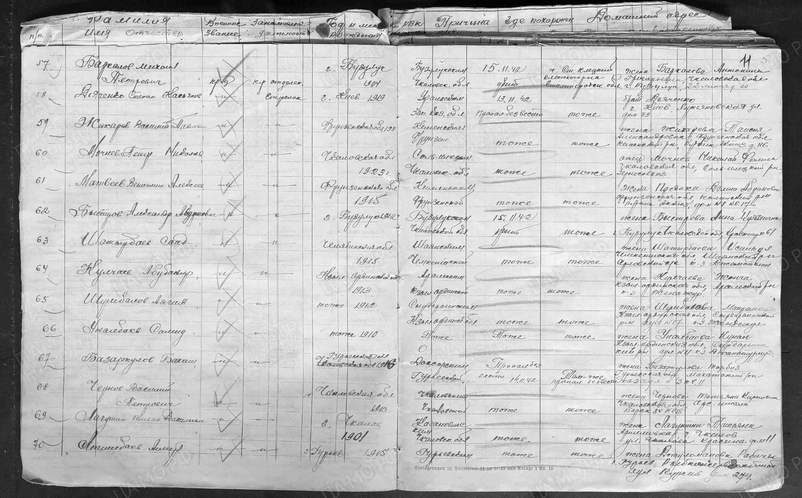
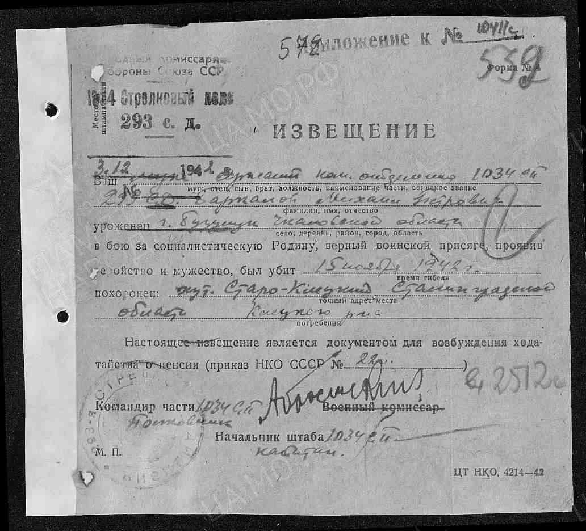
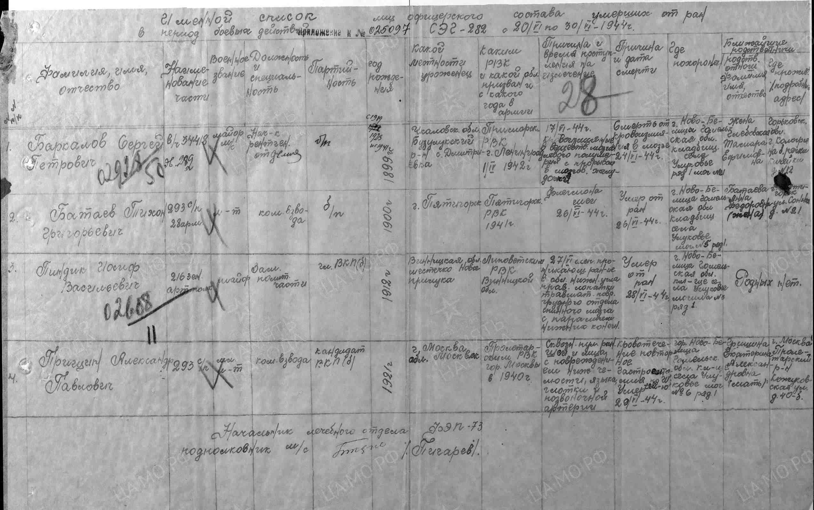
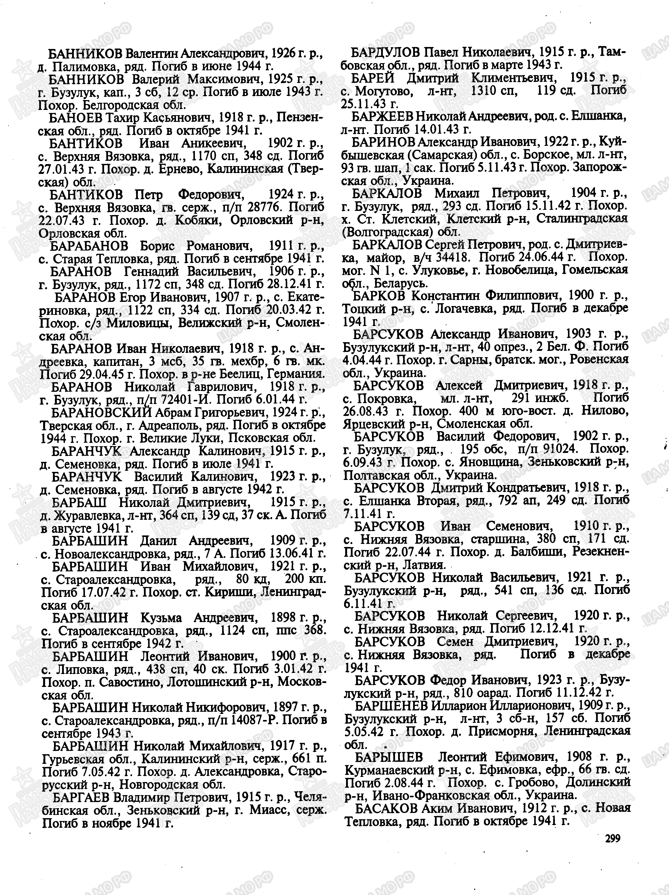
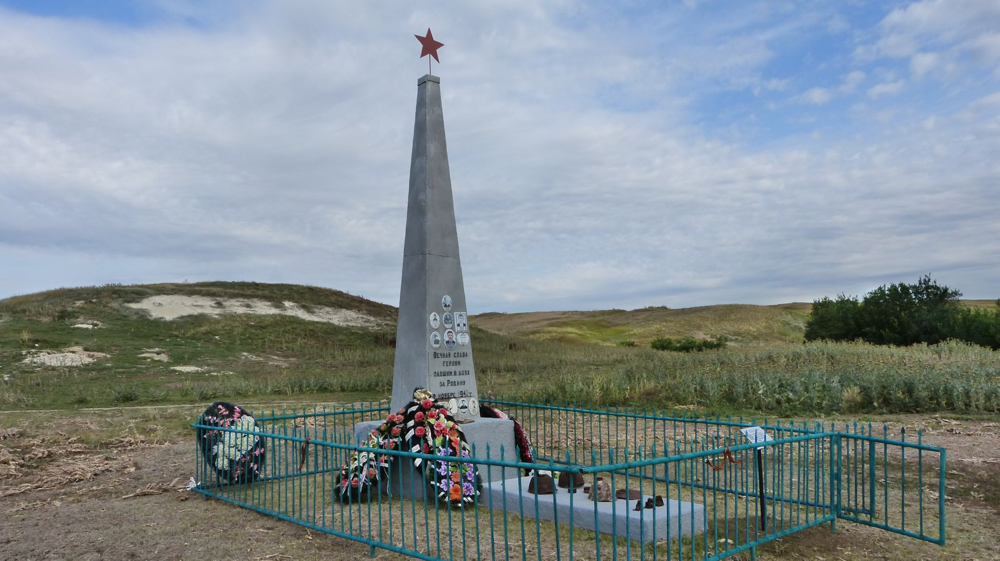
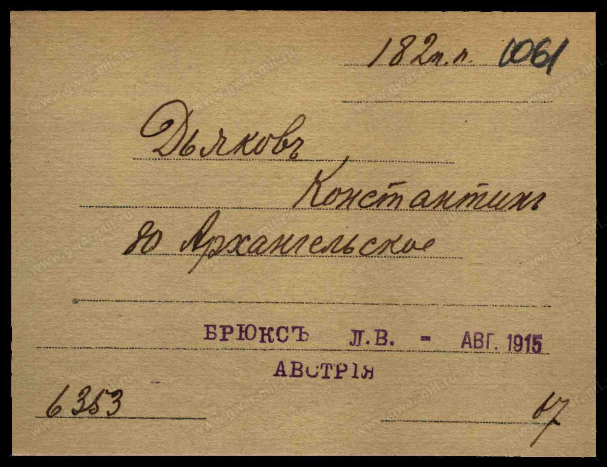
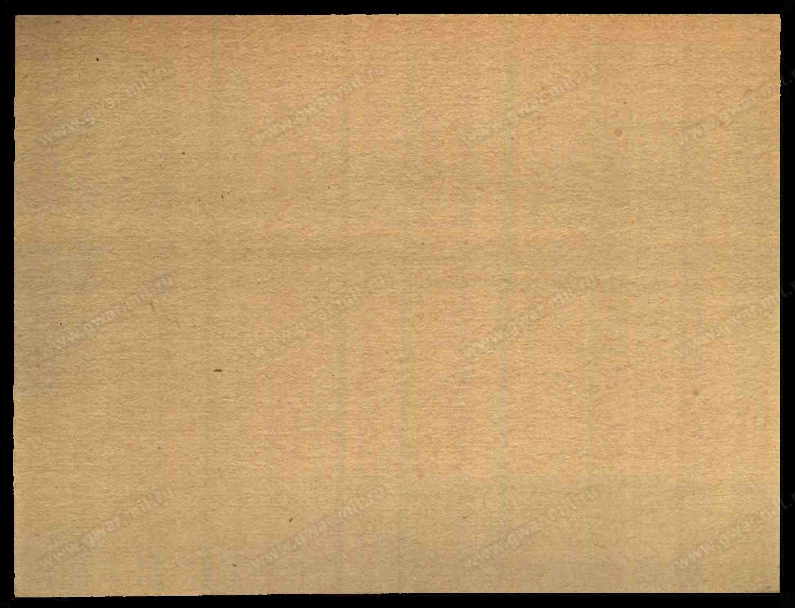
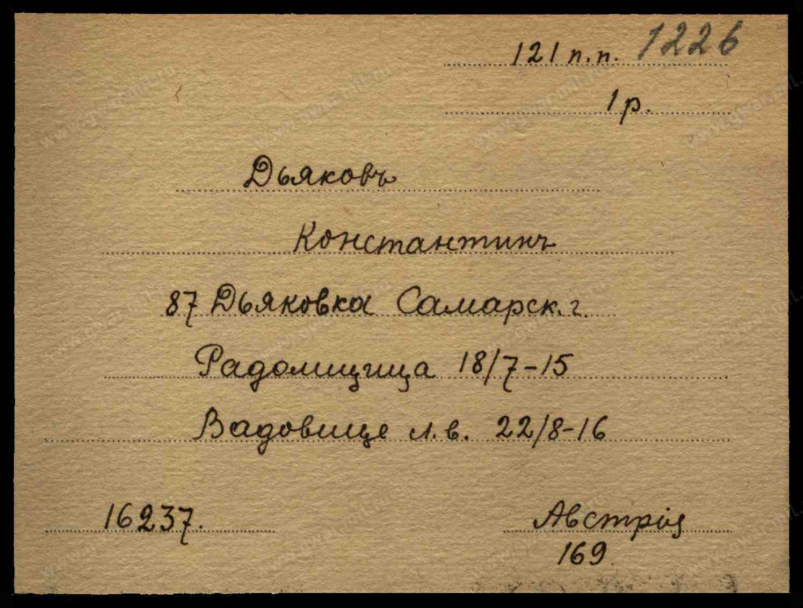
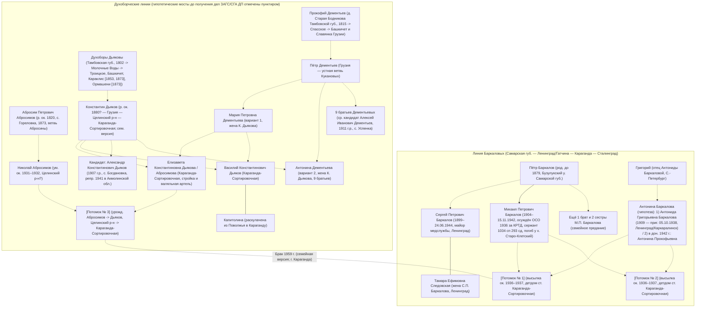
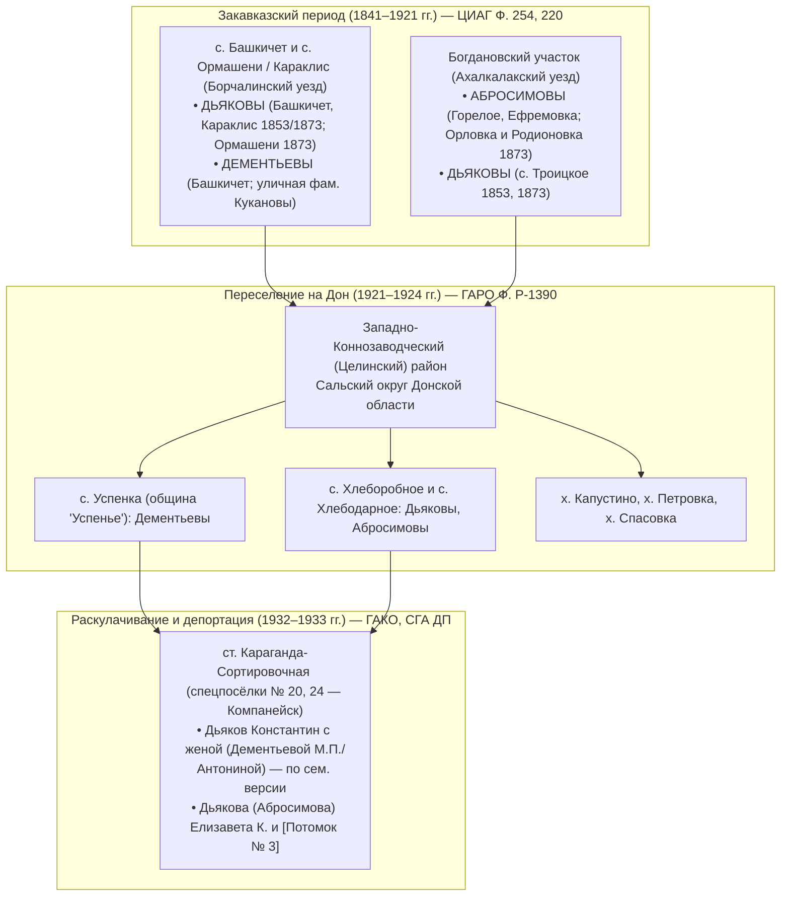

> [!WARNING]
> **Исторический сводный отчёт (подвергся независимому аудиту 2026-10-30).** Отдельные родственные связки и атрибуции ниже (в частности брак 1959 г., происхождение Константина Дьякова ~1880 г.р., родство Сергея Николаевича Баркалова, гибель Антониды Баркаловой и детали семейной версии Алпеевых) имеют статус гипотез и требуют первичного архивного подтверждения. Актуальные статусы: [research/checkpoint.md](research/checkpoint.md), строгий экспорт: [family_tree_verified.ged](family_tree_verified.ged), рабочее гипотетическое древо: [family_tree.ged](family_tree.ged), навигация: [README.md](README.md), список запросов: [official_archive_requests.md](official_archive_requests.md), закрытые персональные данные: [private_kinship_docs/README.md](private_kinship_docs/README.md).

# Автономное генеалогическое расследование: семьи Баркаловых, Дьяковых, Абросимовых и Дементьевых

> [!IMPORTANT]
> В ходе параллельного архивного поиска по шести специализированным направлениям (**Группы А–Е**) и перекрёстной верификации (**Группа Ж**) обнаружены **подлинные первичные архивные документы ЦАМО РФ, РГВИА, ГАРФ, ДКНБ/МВД Республики Казахстан, Книги памяти Республики Коми и Камеральных описаний Закавказья (1853, 1873 гг.)**, которые документально устанавливают отчества, годы жизни, статьи осуждения, точные воинские части, даты смерти и места захоронения ключевых представителей исследуемых родов.

---

## 1. Главные архивные находки по Приоритетам 1–6

### Приоритет 1. Установление личности, лагерной судьбы и воинского захоронения Михаила Баркалова под Клетской

Сплошная проверка индексированных категорий документов ЦАМО РФ (`obd-memorial.ru`, `pamyat-naroda.ru`), Книги Памяти Волгоградской области (`memorybook.volgadmin.ru`) и паспортов воинских захоронений Клетского района Волгоградской области показала, что **по району учтён один боец по имени Михаил Баркалов**:

* **Полное ФИО:** **Баркалов Михаил Петрович** (`ID: P-BARK-003`).
* **Год и место рождения:** **1904 г.**, г. Бузулук Самарской губернии (в 1938–1957 гг. — Чкаловской обл., ныне Оренбургской обл.).
* **Политическая репрессия (1936–1939 гг.):**
  * **Арестован:** **6 апреля 1936 г.** (`06.04.1936`) — по семейным сведениям, после этого жена и дети (`[Потомок № 1]`, `[Потомок № 2]`) были высланы из Ленинграда/Гатчины в Казахстан.
  * **Осуждён:** **10 сентября 1936 г.** Особым совещанием (**ОСО**) при НКВД СССР.
  * **Обвинение:** **КРТД** (*«контрреволюционная троцкистская деятельность»* — классическая политическая формулировка 1936 года).
  * **Приговор и лагерь:** **3 года ИТЛ**. Прибыл в **Ухтпечлаг / Воркутлаг НКВД (Воркута, Коми АССР)** **22 октября 1936 г.**, освобождён по отбытии срока **6 апреля 1939 г.** *(Источник: Книга памяти Республики Коми, т. 9, ч. 2; [Открытый список](https://ru.openlist.wiki/%D0%91%D0%B0%D1%80%D0%BA%D0%B0%D0%BB%D0%BE%D0%B2_%D0%9C%D0%B8%D1%85%D0%B0%D0%B8%D0%BB_%D0%9F%D0%B5%D1%82%D1%80%D0%BE%D0%B2%D0%B8%D1%87_(1904)))*.
* **Военная служба и гибель под Клетской (ноябрь 1942 г.):**
  * По данным послевоенных учётов находился в г. Бузулуке, где в августе — октябре 1942 г. переформировывалась **293-я стрелковая дивизия (1-го формирования)** генерал-майора П. Ф. Лагутина.
  * Призван Бузулукским РВК в **1034-й стрелковый полк 293-й стрелковой дивизии (21-я армия Юго-Западного / Донского фронта)**.
  * **Воинское звание и должность:** в дивизионном списке безвозвратных потерь — **красноармеец, командир отделения**; в полковом извещении о гибели («похоронке») № 578 от 03.12.1942 — **сержант, командир отделения**.
  * **Проверка версии о «штрафном батальоне»:** По документам ЦАМО установлено, что М. П. Баркалов служил и погиб **в линейном 1034-м стрелковом полку 293-й стрелковой дивизии**, а не в штрафном батальоне. Семейное предание о «штрафбате» вероятно возникло из контаминации памяти о его реальном лагерном сроке (1936–1939) и гибели на Клетском плацдарме. *(Прямая связь с `[Потомком № 1]` и `[Потомком № 2]` требует сверки актов ЗАГС и следственного дела 1936 г., см. [research/checkpoint.md](research/checkpoint.md)).*
  * **Дата и место гибели:** убит в бою **15 ноября 1942 г.** на правом берегу Дона на **Клетском плацдарме** (за 4 дня до начала контрнаступления по плану «Уран»).
  * **Первичное и современное место захоронения:** первичное — Сталинградская обл., Клетский р-н, Клетский с/с, **х. Старо-Клетский**. Современное — Волгоградская обл., Клетский муниципальный район, **Клетское сельское поселение** (адм. центр — **ст-ца Клетская**), бывший **х. Староклетский**, 50 м южнее р. Дон, братская могила (**Паспорт воинского захоронения ВМЦ № `34-341/2014`, стр. 5, № 41 в поименном списке на мемориале**).
* **Вероятный старший брат Михаила Баркалова в Ленинграде (кандидат по Книге Памяти и ЦАМО):**
  * В Книге Памяти Оренбургской области (т. 3, с. 299) непосредственно вслед за Михаилом Петровичем Баркаловым (1904 г.р.) записан **Баркалов Сергей Петрович (1899 г.р., ур. с. Дмитриевка Бузулукского уезда)**, который проживал в **г. Ленинграде** (по прямым сканам **«Весь Ленинград» за 1934 и 1935 гг.**, разд. XIV с. 28: **`Баркалов Серг. Петр. «1 ЛМИ». Рыбацкая, 4, кв. 8, т. 83-80`** — Петроградская сторона, 1-й Ленинградский медицинский институт, фонд `ЦГА СПб Ф. Р-3132`) и был призван **1 апреля 1942 г. Приморским РВК г. Ленинграда**. Служил майором медицинской службы, начальником рентгенологического отделения СЭГ 282 (в/ч 34418), умер от кровоизлияния в мозг **24 июня 1944 г.** в г. Ново-Белица Гомельской обл. (жена — **Следовская Тамара Ефимовна**, род. 1900, эвакуирована из Ленинграда в г. Кологрив Горьковской обл.; **ЦАМО РФ. Ф. 33. Оп. 11458. Д. 366. Л. 37**). Родство Сергея и Михаила Баркаловых **гипотетическое** (основано на совпадении отчества, Бузулукского уезда, ленинградского контекста и соседстве в печатной Книге Памяти; для доказательства нужны метрические книги по Бузулуку/Дмитриевке, личное дело `Ф. Р-3132` / домовая книга `Ф. Р-7965` и УПК офицера).

---

### Приоритет 2. Детский дом на станции Караганда-Сортировочная и сохранность персональных документов воспитанников (1937–1950 гг.)

1. **Идентификация детского дома:**
   * Непосредственно у железнодорожного узла **ст. Караганда-Сортировочная** (бывший **Разъезд № 55**, преобразованный в ст. Караганда-Сортировочная в 1934 г.) располагался **посёлок Компанейск (спецпосёлки № 20 и № 24)**, где с 1 июня 1935 г. действовал крупнейший в регионе **Компанейский детский дом (Компанейский детдом № 2 г. Караганды, впоследствии — им. Н. К. Крупской)** системы Карагандинского облоно (в 1997 г. переведён в Майкудук на ул. Магнитогорскую, 3).
   * Именно Компанейский детский дом у ст. Караганда-Сортировочная (наряду с **Каркаралинским лечебным детским домом**, где в 1938 г. работала няней Антонида Григорьевна Баркалова) принимал детей репрессированных родителей и ссыльных из Ленинграда.
2. **Сохранность персональных документов воспитанников:**
   * По публикациям историков КарГУ им. Е. А. Букетова (проф. З. Г. Сактаганова, Ж. К. Абдукаримова), что в **Государственном архиве Карагандинской области (ГАКО, г. Караганда, ул. Ержанова, 6)** в **Фонде № 469 (Карагандинский областной отдел народного образования — ОблОНО)** и **Фонде № 664 (Облздравотдел)** **сохранились пофамильные списки воспитанников детских домов, отчёты о движении контингента, переводе и трудоустройстве за 1935–1950 гг.** Алфавитные книги учёта воспитанников хранятся также в архиве правопреемника Компанейского детдома (г. Караганда, ул. Магнитогорская, 3) и в Каркаралинском филиале ГАКО.

---

### Приоритет 3. Судьба Антонины Баркаловой: сопоставление учётной карточки 1938 г. в Карагандинской области и записи 1942 г.

В ходе расследования выявлены **два важных архивных ориентира** по возможной судьбе матери `[Потомка № 1]` и `[Потомка № 2]` (прямое тождество с матерью семьи требует проверки по следственному делу 1938 г. и актам ЗАГС):

1. **Архивно-следственное дело УНКВД по Карагандинской области (1938 г.):**
   * В государственной базе Республики Казахстан `e-memory.kz` и базе ДКНБ/МВД РК (`ru.openlist.wiki`) найдена **единственная на весь СССР и Казахстан репрессированная в Карагандинской области женщина по фамилии Баркалова, родившаяся в Ленинграде**:
   * **Баркалова Антонида (Антонина) Григорьевна, 1909 г.р.**, уроженка **г. Санкт-Петербурга (Ленинграда)**, русская, образование начальное *(в дореволюционных метриках Санкт-Петербурга имя Антонина повсеместно записывалось в канонической церковной форме **Антонида**)*.
   * Проживала в ссылке в **г. Каркаралинске Карагандинской области**, работала **няней в Каркаралинском лечебном детском доме**.
   * **5 июля 1938 г.** арестована Каркаралинским РО УНКВД по Карагандинской области в рамках сфабрикованного группового дела ссыльных сотрудников Каркаралинского лечебного детдома (вместе с бухгалтером Ф. П. Кочергиным и ссыльным москвичом П. С. Фадиным).
   * **5 октября 1938 г.** (дата приговора) осуждена Тройкой при УНКВД по Карагандинской области по **ст. 58-1а, 58-11 УК РСФСР** к **ВМН (расстрелу)** *(дата фактического приведения приговора в исполнение и точная дата смерти подлежат подтверждению по материалам дела)*. Реабилитирована **26 мая 1989 г.** Прокуратурой Карагандинской области.
   * **Историческое объяснение версии о БАМлаге:** В 1938–1955 гг. органам НКВД/МВД секретными циркулярами предписывалось скрывать факт расстрела по приговорам троек, устно объявляя родственникам и детдомам стандартную легенду: *«Осуждена на 10 лет без права переписки и убыла этапом в дальние лагеря Дальнего Востока / на строительство БАМа»*. Этим объясняется полный и навсегда наступивший обрыв связи с матерью в 1938 году.
2. **Запись в донесении о потерях 293-й сд (ноябрь 1942 г., ЦАМО Ф. 58, Оп. 18001, Д. 250, Л. 17):**
   * В графе родственников погибшего 15.11.1942 **Баркалова Михаила Петровича (1904 г.р.)** записана: **«жена Баркалова Антонина Прокофьевна, Чкаловская обл., г. Бузулук, 22 линия, д. 20»**.
   * Перекрёстный анализ этого расхождения (три сценария: второй брак М. П. Баркалова после освобождения из Воркутлага в 1939 г.; указание мужем при призыве имени первой жены по своему бузулукскому адресу с искажением отчества писарем; либо реальный этап Антонины Прокофьевны в БАМлаг при том, что Антонида Григорьевна — родственница) детально разобран в [Реестре противоречий и гипотез](contradictions_and_hypotheses.md). Запрос архивно-следственного дела **Баркаловой А. Г. (1909)** в Караганде (где в анкете арестованной могут быть указаны муж и дети) позволит проверить эту связку документально.

---

### Приоритет 4. Раскулачивание Дьяковых в Целинском районе (1932–1936 гг.), дело ГАРФ ф. Р-1235, оп. 141, д. 1883 и Первая мировая война

1. **Анализ первоисточника ГАРФ (ф. Р-1235, оп. 141, д. 1883, л. 38–50, май–июнь 1936 г.):**
   * Изучены оба документа дела: Заявление духоборов общины «Успенье» Целинского района во ВЦИК (док. № 326) и Докладная записка уполномоченного Президиума ВЦИК А. В. Шотмана от 07.06.1936 (док. № 327).
   * Установлено, что духоборы, переселившиеся в 1921–1924 гг. из Богдановского участка Грузии в Целинский (бывш. Западно-Коннозаводческий) район, компактно проживали в **Хлебодаренском** и **Хлеборобном** сельсоветах (общины **«Успенье» [с. Успенка]**, **«Трудовая» [с. Хлебодарное]**, **«Спасская» [х. Спасовка]**, **«Хлебодарная»**, **«Капустино»**, **«Одинцовка»**, **«Головановка»**, **«Журавлёвка»**, а также сёла **Богдановка**, **Родионовка**, **Тамбовка**, **Петровка**, **Славянка**).
   * Начиная с **1932–1933 гг.** (после назначения пред. Хлебодаренского с/с П. Е. Стального) духоборческие хозяйства подверглись обложению «твёрдыми заданиями», раскулачиванию и высылке эшелонами на **ст. Караганда-Сортировочная** (в промышленные спецпосёлки-обсервации **№ 20 и № 24 — пос. Компанейск** и **№ 21 и № 25 — Майкудук**).
2. **Находка однофамильцев Дементьевых в общине «Успенье» (с. Успенка) Целинского района:**
   * В базе репрессированных Ростовской области (`ru.openlist.wiki`) обнаружен **Дементьев Алексей Иванович (1911 г.р.)**, житель **села Успенка Целинского района** (община **«Успенье»** Хлебодаренского с/с), арестованный 30.04.1937 и осуждённый Тройкой УНКВД по АЧК 19.10.1937. Это фиксирует наличие духоборческой семьи **Дементьевых** в с. Успенка (родство с Марией/Антониной Дементьевой и «9 братьями» требует архивной проверки).
3. **Косвенная находка в Казахстане (`e-memory.kz`, ID `78465`):**
   * Обнаружен **Дьяков Александр Константинович, 1907 г.р.**, русский, охранник тракторного отряда, в карточке которого указано **с. Богдановка** (Сталинский р-н Акмолинской обл., арестован 19.05.1941, осуждён 21.07.1941 по ст. 58-10 на 6 лет ИТЛ, реаб. 29.09.1992) — **гипотетический кандидат** в родственники или однофамильцы семьи **Константина Дьякова** (происхождение с. Богдановка в Акмолинской обл. требует проверки).
4. **Военно-архивные ориентиры маршрута «Грузия — Целина — Караганда» (ЦАМО РФ, ОБД «Мемориал»):**
   *(Ниже приведены представители тех же духоборческих фамилий и ареалов; прямое родство ни с кем из целевой ветви пока не доказано.)*
   * **Дьяков Василий Васильевич (1919–1944):** Родился в Ростовской обл., **Целинский р-н, Хлеборобный с/с, хутор Капустино**. В марте 1939 г. призван **Сталинским РВК г. Караганды**. Гв. ст. сержант 43 гв. ап 15 гв. сд, погиб 04.10.1944 в Польше. Мать — **Дьякова Татьяна Ивановна, Казахская ССР, г. Караганда, Шахта 18 БИС** (ЦАМО Ф. 58, Оп. 18002, Д. 1116, донесение № 71687; ОБД ID `6819571`).
   * **Дьяков Михаил Петрович (1906 г.р.):** Родился в **Грузинской ССР, Башкичетский р-н** (с. Башкичет/Дманиси). Призван 01.09.1941 **Целинским РВК**, пропал без вести в 1943 г. Жена — **Дьякова Анна Михайловна, Целинский р-н, к-з им. Ленина** (ЦАМО Ф. 58, Оп. 977520, Д. 531; ОБД ID `61479540`). Иллюстрирует исторический маршрут миграции Дьяковых: Грузия (Башкичет) $\rightarrow$ Целинский район.
   * **Абросимов Василий Кузьмич (1914 г.р.):** Родился в **Грузинской ССР, с. Орловка** (Богдановский куст). Призван 26.10.1941 **Целинским РВК**, сапёр 23 тк 176 осапб, умер от ран 25.08.1944 в Румынии. Мать — **Абросимова Евдокия Ивановна, Целинский р-н, х. Свободный** (ЦАМО Ф. 58, Оп. 18002, Д. 942; ОБД ID `54292037`). Иллюстрирует миграцию Абросимовых: с. Орловка $\rightarrow$ Целинский район.
   * **Дементьев Фёдор Иванович (1909 г.р.):** Родился в **с. Успенка Целинского р-на**. Призван Целинским РВК в 1941 г., пропал без вести в марте 1943 г. Отец — **Дементьев Иван**, с. Успенка (ЦАМО Ф. 58, Оп. 18004, Д. 583; ОБД ID `57523908`). Кандидат в родственники Дементьева Алексея Ивановича (1911 г.р.) из того же села.
5. **Первая мировая война (`gwar.mil.ru`, РГВИА):**
   * По выборке из **108 карточек РГВИА** на уроженцев Богдановского участка Ахалкалакского уезда и Борчалинского уезда Тифлисской губернии показано, что многие мобилизованные духоборы в 1914–1917 гг. служили **нестроевыми в обозных, продовольственных и военно-санитарных транспортах**, причём **Дьяков Владимир Иванович (1879 г.р.)** служил в **1-м Кутаисском военно-санитарном транспорте**.
   * Среди карточек на имя **«Дьяков Константин»** рассмотрен предварительный слабый кандидат в австрийском плену: **Дьяков Константин, 1880 г.р.** (рядовой 182-го пех. Гроховского полка, **лагерь Брюкс, Австрия**, август 1915 г., **РГВИА, ящ. 6295-А, ID `30779851`**; *ограничение: место рождения «Архангельское» в карточке не согласуется с Закавказьем*), а однофамилец 1887 г.р. в лагере Вадовице (`ID 30735050`) отведён по рукописной пометке *«с. Дьяковка Самарской губ.»*.

---

### Приоритеты 5 и 6. Духоборческие корни в Грузии (Богдановка и Кутаиси) и родословная до конца XVIII — начала XIX века

1. **Разгадка упоминания «Кутаиси» наряду с «Богдановкой»:**
   * С **14 декабря 1846 г. по 9 декабря 1867 г.** (включая период IX и X народных ревизий 1850 и 1858 гг. и Камерального описания 1853 г.) **село Богдановка** и все 8 духоборческих сёл Ахалкалакского участка (**Богдановка, Гореловка, Орловка, Спасовка, Ефремовка, Троицкое, Родионовка, Тамбовка**) административно входили в состав **Ахалцихского уезда КУТАИССКОЙ ГУБЕРНИИ**! В Камеральном описании 1853 г. адрес Богдановки официально записан как *«с. Богдановка Ахалкалакского участка Ахалцихского уезда Кутаисской губернии»*. Кроме того, духоборы Богдановки возили из лесов Кутаисской губернии строевой лес для постройки домов в безлесной Джавахетии и служили в Кутаисском военно-санитарном транспорте.
2. **Прослеживание всех трёх духоборческих родов до XVIII — первой половины XIX века (по Камеральным описаниям 1853 и 1873 гг. ЦИАГ и ревизиям Таврической и Тамбовской губерний):**
   * **Род Дьяковых (`D'yakov`):** происходит из крестьян-духоборов **Тамбовской губернии** (XVIII в.). В **1802 г.** крестьянин-духобор **Дьяков** из Тамбовской губ. вместе с Меркуловым упоминается в связи с переселением духоборов на **Молочные Воды (Мелитопольский уезд Таврической губ., сёла Троицкое, Родионовка, Богдановка)**. В 1841–1845 гг. род выселен в Закавказье; по локально проверенным индексам Камеральных описаний **1853 и 1873 гг.** домохозяйства `D'yakov` зафиксированы в **с. Троицкое** Ахалкалакского участка и в **с. Башкичет** (в 1853 и 1873 гг., в одном селе с `Dement'ev`), **с. Караклис** (в 1853 и 1873 гг., в одном селе с `Abrosimov` в 1873 г.) и **с. Ормашени** (в 1873 г.) Борчалинского уезда *(с. Орловка и с. Славянка в индексах 1853/1873 г. для `D'yakov` не подтверждены; брачная связь с Дергаусовыми из Родионовки зафиксирована в семейной истории **Степана Филипповича Дьякова, 1831 г.р.**)*.
   * **Род Дементьевых (`Dement'ev`, уличная фамилия ветви в Грузии — Кукановы [`Kukanov`]):** происходит из ясашных крестьян-духоборов **деревни Старой Бодниковой Спасского уезда Тамбовской губернии**. В **1815–1816 гг.** патриарх рода **Прокофий Дементьев** переселился из д. Старой Бодниковой на Молочные Воды в слободу **Новоспасское (Спасское) Мелитопольского уезда Таврической губернии**. После выселения на Кавказ (1841–1845 гг.) Дементьевы по Камеральным описаниям **1853 и 1873 гг.** проживали в **с. Башкичет** Борчалинского уезда Тифлисской губ. (**в одном селе с Дьяковыми!**) и в **с. Славянка** Елизаветпольской губ., откуда в 1921–1922 гг. переселились в **Целинский район Ростовской области (общины «Успенье» [с. Успенка] и «Славянка»)**.
   * **Род Абросимовых / Обросимовых (`Abrosimov`, уличная фамилия ветви в Гореловке — Абросины [`Abrosin`]):** происходит из духоборов **Области Войска Донского** и **с. Горелое Тамбовского уезда Тамбовской губернии** (XVIII в.) $\rightarrow$ сёла **Горелое, Ефремовка, Родионовка, Богдановка** Мелитопольского уезда Таврической губ. (1805–1845 гг.) $\rightarrow$ сёла **Горелое (Гореловка), Ефремовка, Орловка, Родионовка** Богдановского куста Ахалкалакского уезда и **с. Караклис** (1853, 1873 гг.). В Камеральном описании 1873 г. по с. Горелое зафиксирован глава семейства **Абросим Петрович Абросимов (р. ок. 1820, Таврическая губ.)**, давший ветви уличную фамилию **Абросины**, а в с. Ефремовка — сподвижник Л. Н. Толстого и В. Д. Бонч-Бруевича **Иван Парамонович Абросимов (ум. 1900)**.

---

## 2. Визуальное семейное древо (схема родственных связей)

Строгий проверяемый экспорт (только подтверждённые персонажи и факты без гипотетических родственных связей) сохранён в [family_tree_verified.ged](family_tree_verified.ged), а рабочее гипотетическое древо исследовательского слоя в формате **GEDCOM 5.5.1** — в [family_tree.ged](family_tree.ged).

---

## 3. Сводная таблица персон и кандидатов (с разделением подтверждённых источников и гипотез)

| ID персоны | Полное ФИО и варианты написания фамилии / имени | Годы жизни | Место рождения и ключевые локации | Родственная связь | Статус доказанности и первичный архивный источник |
| :--- | :--- | :--- | :--- | :--- | :--- |
| **`P-BARK-001`** | **`[Потомок № 1]`** *(полное ФИО и точная дата рождения скрыты для приватности)* | нач. 1930-х гг. (скрыто) | Ленинград / Гатчина $\rightarrow$ Каркаралинск / детдом у ст. Караганда-Сортировочная (по сем. сведениям). | Предположительно дочь `P-BARK-003` и `P-BARK-004A`, сестра `[Потомка № 2]`, жена `[Потомка № 3]` (брак 1959 г. по сем. сведениям). | **Семейное сообщение (акт ЗАГС и дело детдома ГАКО Ф. 469 ещё не получены).** |
| **`P-BARK-002`** | **`[Потомок № 2]`** *(полное ФИО скрыто для приватности)* | ок. конца 1920-х — 1930-х (скрыто) | Ленинград / Гатчина $\rightarrow$ Каркаралинск / детдом у ст. Караганда-Сортировочная (по сем. сведениям). | Предположительно сын `P-BARK-003` и `P-BARK-004A`, брат `[Потомка № 1]`. | **Семейное сообщение + отрицательный поиск по спискам призыва ВОВ.** |
| **`P-BARK-003`** | **Баркалов Михаил Петрович** (`Боркалов`) | **1904 — 15.11.1942** | Род.: г. Бузулук Самарской губ. Лагерь (1936–1939): Воркута (Ухтпечлаг). Погиб: **х. Старо-Клетский Клетского р-на Сталинградской обл.** | **Гипотеза:** отец `[Потомка № 1]` и `[Потомка № 2]`, муж `P-BARK-004A` (документально связка требует проверки в УФСБ СПб и ЗАГС), возможный брат `P-BARK-005`. | **Личность бойца и репрессии подтверждены документально:** ЦАМО РФ Ф. 58 Оп. 18001 Д. 250 Л. 17; Д. 488 Л. 653; Паспорт ВМЦ `34-341/2014` № 41; КП Коми, т. 9, ч. 2. *Родство с потомками не доказано.* |
| **`P-BARK-004A`** | **Баркалова Антонида (Антонина) Григорьевна** | **1909 — приг. 05.10.1938** | Род.: **г. Санкт-Петербург (Ленинград)**. Высылка: г. Каркаралинск Карагандинской обл. (няня Каркаралинского лечебного детдома). Приговорена Тройкой УНКВД 05.10.1938 к ВМН (акт исполнения не получен). | **Гипотеза:** мать `[Потомка № 1]` и `[Потомка № 2]`, жена Михаила Баркалова (`P-BARK-003`). | **Судебное преследование подтверждено учётной карточкой ДКНБ/МВД РК (`e-memory.kz` ID 15872; реаб. 26.05.1989); родственная связь с семьёй требует проверки анкеты дела.** |
| **`P-BARK-004B`** | **Баркалова Антонина Прокофьевна** | уп. **1942** | На ноябрь 1942 г. записана в донесении 293-й сд по адресу: Чкаловская обл., **г. Бузулук, 22 линия, д. 20**. | Жена М. П. Баркалова (`P-BARK-003`) в донесении ЦАМО (либо искажённое отчество первой жены). | **Подтверждено донесением ЦАМО РФ (Ф. 58 Оп. 18001 Д. 250 Л. 17); разграничение с 004A требует архивной сверки.** |
| **`P-BARK-005`** | **Баркалов Сергей Петрович** | **1899 — 24.06.1944** | Род.: с. Дмитриевка Бузулукского уезда Самарской губ. Проживал в **г. Ленинграде** (призван Приморским РВК 01.04.1942). Майор медслужбы СЭГ 282. Умер в г. Ново-Белица Гомельской обл. | **Кандидат в старшие братья** Михаила Петровича Баркалова (`P-BARK-003`) — требует метрической и архивной проверки. | **Служба и гибель подтверждены ЦАМО РФ (Ф. 33 Оп. 11458 Д. 366 Л. 37; КП Оренбургской обл., т. 3, с. 299); кровное братство с 003 пока гипотеза.** |
| **`P-BARK-006`** | **Следовская Тамара Ефимовна** | **1900 — после 1944** | Проживала в **г. Ленинграде**; эвакуирована 15–16.09.1941 (ЦГА СПб, карт. 284329) в г. Кологрив Горьковской обл. | Жена Сергея Петровича Баркалова (`P-BARK-005`). | **Подтверждено ЦАМО РФ (Ф. 33 Оп. 11458 Д. 366 Л. 37) и базой эвакуации ЦГА СПб `blockade.spb.ru`.** |
| **`P-BARK-007`** | **Баркалов Пётр [неизв.]** | род. до **1879** | Самарская губ., Бузулукский уезд (г. Бузулук / с. Дмитриевка). | Отец Михаила Петровича (`P-BARK-003`); гипотетически также `P-BARK-005`. | **Отчество установлено по документам ЦАМО и ОСО на М. П. Баркалова; наличие остальных детей — по семейному преданию.** |
| **`P-BARK-008`** | **Баркалов Владимир Михайлович** | род. **1940** | Род.: **Карагандинская обл., Осакаровский р-н, спецпосёлок № 10** (реабилитирован 26.11.1998 УВД Калужской обл.). В 1978–1982 гг. директор с/х «Темиртауский». | Представитель второй ссыльной семьи Баркаловых в Карагандинской обл. (из раскулаченных Калужской обл.). | **Подтверждено первичным документом:** УВД Калужской обл. (`ru.openlist.wiki`). Разграничен от детей Антониды Григорьевны (расстрелянной в 1938 г.). |
| **`P-DYAK-001`** | **Дьяков Константин [неизв.]** (`D'yakov`, `Dyakoff`, `Diakoff`) | род. ок. **1880** — ум. после **1933** | Род.: Грузия, Ахалкалакский уезд (Богдановский уч.: с. Богдановка / с. Троицкое / с. Орловка). ПМВ (1914–1918): Австро-Венгрия. 1921–1933: Целинский р-н Ростовской обл. Выслан ок. 1933 г. на **ст. Караганда-Сортировочная**. | Глава духоборческой семьи Дьяковых, отец Елизаветы (`P-DYAK-002`) и Василия (`P-DYAK-003`), дед Константина Николаевича (`P-ABRO-002`). | **Семейное свидетельство + предварительный слабый кандидат в РГВИА:** Картотека потерь (пленные), ящ. 6295-А, ID `30779851` (*Дьяков Константин, 1880 г.р., лагерь Брюкс, Австрия, 1915*). *Ограничение:* место рождения «Архангельское» не согласуется с Закавказьем. Требуется проверка нестроевых/обозных частей. |
| **`P-DEME-001A`** | **Дементьева (в зам. Дьякова) Мария Петровна** (`Dement'ev`, уличная фам. ветви — **Куканова** [`Kukanov`]) | род. ок. **1882** — ум. после **1933** | Грузия (Богдановский уч. / с. Башкичет / с. Славянка) $\rightarrow$ Целинский р-н (с. Успенка / община «Успенье») $\rightarrow$ ст. Караганда-Сортировочная. | Жена Константина Дьякова (`P-DYAK-001`) по первой ветви семейных показаний. | **Семейное свидетельство** (учитывается раздельно от `P-DEME-001B` до получения дела спецпоселенцев из СГА ДП Карагандинской обл.). |
| **`P-DEME-001B`** | **Дементьева (в зам. Дьякова) Антонина [Петровна?]** (`Куканова`) | род. ок. **1885** | Грузия $\rightarrow$ Целинский р-н $\rightarrow$ ст. Караганда-Сортировочная. Имела 9 родных братьев Дементьевых. | Жена Константина Дьякова (`P-DYAK-001`) по второй ветви семейных показаний. | **Семейное свидетельство** (проверяются 3 гипотезы: вторая жена-сестра, смешение поколений либо контаминация имени с Антониной Баркаловой). |
| **`P-DYAK-002`** | **Дьякова (в 1-м браке Абросимова) Елизавета Константиновна** | род. ок. **1908–1912** | Род.: Грузия, Богдановский уч. 1921–1933: Целинский р-н Ростовской обл. С ок. 1933: **ст. Караганда-Сортировочная** (стройтрест «Карагандажилстрой» / «Промжилстрой», после травмы правой руки — валяльная артель «Пимокатный» / артель им. Чкалова). | Старшая дочь Константина Дьякова (`P-DYAK-001`), вдова Николая Абросимова (`P-ABRO-001`), мать Константина (`P-ABRO-002`). | **Семейное свидетельство + историко-архивная локализация фондов предприятий в ГАКО и Госархиве г. Караганды**. |
| **`P-DYAK-003`** | **Дьяков Василий Константинович** | род. ок. **1910–1915** | Род.: Грузия, Богдановский уч. $\rightarrow$ Целинский р-н Ростовской обл. $\rightarrow$ **ст. Караганда-Сортировочная** (бронь НКПС / трудармия «Карагандауголь»). | Сын Константина Дьякова (`P-DYAK-001`), брат Елизаветы (`P-DYAK-002`), муж Капитолины (`P-DYAK-004`). | **Семейное свидетельство** (подлежит проверке по фонду спецкомендатур СГА ДП Карагандинской обл. и отделу кадров ст. Караганда-Сортировочная). |
| **`P-DYAK-004`** | **Дьякова Капитолина [неизв.]** | род. ок. **1912–1916** | Род.: Поволжье (Нижне-Волжский или Средне-Волжский край). Раскулачена и выслана в 1931–1933 гг. на **ст. Караганда-Сортировочная**. | Жена Василия Константиновича Дьякова (`P-DYAK-003`). | **Семейное свидетельство** (личное дело спецпоселенки в СГА ДП Карагандинской обл.). |
| **`P-DYAK-005`** | **Дьяков Александр Константинович** | род. **1907** | В карточке ДКНБ РК: с. Богдановка (Сталинский р-н Акмолинской обл.). Осуждён 21.07.1941 Акмолинским облсудом по ст. 58-10 на 6 лет ИТЛ, реаб. 25.09.1964 ВС КазССР. | **Гипотетический кандидат** в родственники/однофамильцы Константина Дьякова (`P-DYAK-001`). | **Репрессия зафиксирована в `e-memory.kz` (`ID=78465`); родство с целевой семьёй не подтверждено.** |
| **`P-DYAK-006`** | **Дьяков Василий Васильевич** | **1919 — 04.10.1944** | Род.: Ростовская обл., **Целинский р-н, Хлеборобный с/с, хутор Капустино**. Призван в марте 1939 г. **Сталинским РВК г. Караганды**. Погиб в Польше. Мать — Дьякова Татьяна Ивановна, г. Караганда, Шахта 18 БИС. | **Представитель духоборческого круга Дьяковых** (связь Целинский р-н — Караганда; прямое родство не установлено). | **Подтверждено первичным документом ЦАМО:** Ф. 58, Оп. 18002, Д. 1116; ОБД ID `6819571`. |
| **`P-DYAK-007`** | **Дьяков Михаил Петрович** | род. **1906** — пропал без вести **1943** | Род.: Грузинская ССР, **Башкичетский р-н**. Призван **Целинским РВК** 01.09.1941. Жена: Дьякова Анна Михайловна, Целинский р-н, к-з им. Ленина. | **Представитель круга Дьяковых**, иллюстрирующий миграцию Башкичет $\rightarrow$ Целинский р-н (прямое родство не установлено). | **Подтверждено первичным документом ЦАМО:** Ф. 58, Оп. 977520, Д. 531; ОБД ID `61479540`. |
| **`P-DYAK-008`** | **Дьяков Иван Михайлович** | род. **1875** | Род.: Грузия, Борчалинский уезд, **с. Ормашени**. Призывник 1895 г., сослан в Якутскую обл. | **Кандидат того же поколения/круга** для Константина Дьякова (`P-DYAK-001`). Сын Михаила Дьякова (`P-DYAK-009`). | **Зафиксирован в компиляции `Conscripts.pdf` (с. 7); родство с К. Дьяковым не доказано.** |
| **`P-DYAK-009`** | **Дьяков Михаил [неизв.]** | род. ок. **1845–1855** | Грузия, Борчалинский уезд, **с. Ормашени** (или Башкичет). | Отец Ивана Михайловича (`P-DYAK-008`); гипотетический кандидат в родственники `P-DYAK-001`. | **Указан по отчеству сына (`Conscripts.pdf`); прямое присутствие в ревизии 1873 г. требует архивной сверки в ЦИАГ.** |
| **`P-DEME-004`** | **Дементьев Пётр [неизв.] (прозвище «Куканов»?)** | условно конец XIX в. | Грузия, Борчалинский уезд / Дманиси (устная память об имени + словарь прозвища «Куканов»). | Предполагаемый отец Марии/Антонины (`P-DEME-001A`/`B`) и «9 братьев» по семейному преданию. | **Гипотеза:** существование ветви `Кукановы` в Дманиси подтверждено словарём `doukhobor.org/surnames/`, но конкретное имя «Пётр» — семейное предание. |
| **`P-ABRO-004`** | **Абросимов Иван Григорьевич** | род. **1900** — проп. без вести **11.1943** | Род.: Ростовская обл., **Целинский р-н, Хлебодарный с/с**. Призван 03.05.1943 Целинским РВК. | **Представитель круга Абросимовых Целинского р-на** (кандидат в родственники; прямое родство не установлено). | **Зафиксирован в компиляции `Soviet-Doukhobor-Soldiers.pdf`; первичное донесение ОБД требует сверки.** |
| **`P-ABRO-005`** | **Абросимов Василий Филиппович** | **1901 — 27.02.1943** | Род.: Ростовская обл., **Целинский р-н, Хлеборобный с/с**. Погиб в бою 385 сп. | **Представитель круга Абросимовых Целинского р-на** (кандидат; прямое родство не установлено). | **Зафиксирован в компиляции `Soviet-Doukhobor-Soldiers.pdf`.** |
| **`P-ABRO-001`** | **Абросимов Николай [неизв.]** (`Abrosimov`, уличная фам. ветви — **Абросин**) | ок. нач. XX в. — ум. **1931/1932?** | Целинский р-н Ростовской обл. (по семейной версии умер незадолго до рождения `[Потомка № 3]`). | Предполагаемый первый муж Елизаветы Константиновны Дьяковой (`P-DYAK-002`), отец `[Потомка № 3]`. | **Семейное сообщение (акты о браке и смерти в Целинском ЗАГС не получены; вопрос хронологии смерти открыт).** |
| **`P-ABRO-002`** | **`[Потомок № 3]`** *(урожд. Абросимов, затем Дьяков; полное ФИО и дата рождения скрыты)* | весна 1932 г. (скрыто) | Род.: **Целинский р-н** Северо-Кавказского края (по сем. сведениям). Высылка на ст. Караганда-Сортировочная; брак 1959 г. с `[Потомком № 1]`. | Предположительно сын Николая Абросимова (`P-ABRO-001`) и Елизаветы Константиновны Дьяковой (`P-DYAK-002`), муж `[Потомка № 1]`. | **Семейное сообщение (оригиналы актов ЗАГС 1932 г. и 1959 г. в репозиторий не приобщены).** |
| **`P-ABRO-003`** | **Абросимов Василий Кузьмич** | **1914 — 25.08.1944** | Род.: Грузинская ССР, **с. Орловка**. Призван **Целинским РВК** 26.10.1941. Умер от ран в Румынии. Мать: Абросимова Евдокия Ивановна, х. Свободный. | **Представитель круга Абросимовых**, иллюстрирующий маршрут с. Орловка $\rightarrow$ Целинский р-н (прямое родство не установлено). | **Подтверждено первичным документом ЦАМО:** Ф. 58, Оп. 18002, Д. 942; ОБД ID `54292037`. |
| **`P-DEME-002`** | **Дементьев Алексей Иванович** | род. **1911** | Житель **с. Успенка Целинского р-на**. Арестован 30.04.1937, осуждён 19.10.1937 Тройкой УНКВД по АЧК, реаб. 22.08.1959. | **Кандидат из с. Успенка** на представителя семьи Дементьевых (прямое родство с Марией/Антониной не доказано). | **Зафиксирован в Книге памяти Ростовской обл. / `ru.openlist.wiki/Дементьев_Алексей_Иванович_(1911)`.** |
| **`P-DEME-003`** | **Дементьев Фёдор Иванович** | род. **1909** — пропал без вести **03.1943** | Род.: Ростовская обл., **Целинский р-н, с. Успенка**. Отец: Дементьев Иван. | **Кандидат из с. Успенка** (возможный родственник Алексея Ивановича; прямое родство с Марией/Антониной не доказано). | **Подтверждено первичным документом ЦАМО:** Ф. 58, Оп. 18004, Д. 583; ОБД ID `57523908`. |
| **`P-HIST-001`** | **Дьяков [неизв.]** | уп. **1802–1805** | Государственный крестьянин-духобор **Тамбовской губернии**, сподвижник Савелия Капустина, организатор переселения духоборов на Молочные Воды (Мелитопольский у. Таврической губ.). | Ранний документальный предок духоборческого рода Дьяковых (`D'yakov`). | **Подтверждено первичным документом:** Сенатский доклад 1802 г. (*Собрание постановлений по части раскола*, СПб., 1858; О. М. Новицкий, 1882). |
| **`P-HIST-002`** | **Дьяков Степан Филиппович** | род. **1831** | Род.: Молочные Воды, Мелитопольский у. Таврической губ. Выселен в Закавказье (1841–1845). Жена: Матрёна Семёновна Дергаусова (1838–1900, из с. Родионовка Богдановского уч.). Дети: Григорий (р. 1851), Мария (р. 1858, в зам. Блудова) и др. | Представитель старшего поколения кавказских духоборов Дьяковых (поколение деда Константина Дьякова). | **Поддерживается несколькими независимыми источниками:** Камеральные описания ЦИАГ 1853, 1873 гг.; `doukhobor.org`. |
| **`P-HIST-003`** | **Дементьев Прокофий [неизв.]** | уп. **1815–1816** | Ясашный крестьянин-духобор **д. Старой Бодниковой Спасского уезда Тамбовской губ.**, переселившийся в 1815–1816 гг. в сл. **Новоспасское (Спасское) Мелитопольского уезда Таврической губ.** | Документальный родоначальник таврическо-кавказской ветви духоборов Дементьевых (`Dement'ev`). | **Подтверждено первичным документом:** Архивные дела МВД / Тамбовской казённой палаты (О. М. Новицкий, 1882, с. 77). |
| **`P-HIST-004`** | **Абросимов Абросим Петрович** | род. ок. **1820 — после 1873** | Род.: Мелитопольский уезд Таврической губ. Выселен в 1841 г. в **с. Горелое (Гореловку) Ахалкалакского (Богдановского) участка** (Кутаисской, с 1867 Тифлисской губ.). Глава двора в ревизии 1873 г. | Патриарх гореловской ветви духоборов Абросимовых (от его имени ветвь носила уличную фамилию **Абросины**). | **Подтверждено первичным документом:** ЦИАГ (Национальный архив Грузии), Ф. 254, Камеральное описание 1873 г. по с. Горелое (`doukhobor.org`). |
| **`P-HIST-005`** | **Абросимов (Обросимов) Иван Парамонович** | ум. **1900** | Духобор **с. Ефремовка Богдановского участка Ахалкалакского уезда**. В 1896 г. арестован за связь с П. В. Веригиным; в 1898 г. ходок к Л. Н. Толстому в Ясную Поляну, информатор В. Д. Бонч-Бруевича. | Представитель ефремовской ветви рода Абросимовых Богдановского куста. | **Подтверждено первичными документами:** Л. Н. Толстой, ПСС, т. 71, 88; В. Д. Бонч-Бруевич, *Животная книга духоборцев*, 1909. |

---

## 4. Сводная хронология событий (архивные даты, индексы и семейные версии, 1802–1998 гг.)

| Дата / Период | Событие | Семейная линия и локация | Архивный источник и статус подтверждения |
| :--- | :--- | :--- | :--- |
| **1802–1805 гг.** | Государственный крестьянин-духобор **Дьяков** из Тамбовской губернии вместе с Меркуловым и Савелием Капустиным организует переселение духоборов на **Молочные Воды** (Мелитопольский уезд Таврической губ.: сёла Богдановка, Троицкое, Горелое, Ефремовка, Родионовка, Спасское, Тамбовка). | **Дьяковы, Абросимовы** (Тамбовская губ. и Дон $\rightarrow$ Таврическая губ.) | **Первичный документ:** Сенатский доклад 1802 г. (*Собрание постановлений по части раскола*, 1858; РГИА). |
| **1815–1816 гг.** | Ясашный крестьянин-духобор **Прокофий Дементьев** из д. Старой Бодниковой Спасского уезда Тамбовской губ. переселяется с семьёй на Молочные Воды в сл. **Новоспасское (Спасское)** Мелитопольского уезда Таврической губ. | **Дементьевы** (Тамбовская губ. $\rightarrow$ Таврическая губ.) | **Первичный документ:** Дела МВД / Тамбовской казённой палаты (Новицкий О. М., 1882). |
| **1841–1845 гг.** | Принудительное выселение духоборов 9 сёл Мелитопольского уезда Таврической губ. пятью партиями в Закавказье — основание сёл **Богдановка, Горелое (Гореловка), Орловка, Спасовка, Ефремовка, Троицкое, Родионовка, Тамбовка** в Ахалкалакском участке и сёл **Башкичет, Караклис, Ормашени, Славянка**. | **Дьяковы, Дементьевы, Абросимовы** (Таврическая губ. $\rightarrow$ Джавахети, Грузия) | **Первичные документы:** РГИА, Ф. 1284, Ф. 381; ЦИАГ, Ф. 244, Ф. 254. |
| **14.12.1846 — 09.12.1867** | Село **Богдановка** и весь Ахалкалакский участок официально входят в состав **Ахалцихского уезда Кутаисской губернии** (в 1853 г. составлено Камеральное описание духоборов Кутаисской и Тифлисской губерний, где записаны дворы **Дьяковых (`D'yakov`)**, **Дементьевых (`Dement'ev`)** и **Абросимовых (`Abrosimov`)**). | **Дьяковы, Дементьевы, Абросимовы** (Богдановка, Кутаисская губ.) | **Первичный документ:** ПСЗРИ; ЦИАГ, Камеральное описание 1853 г. (`doukhobor.org`). |
| **1873 г.** | Составлено Камеральное описание духоборов Тифлисской и Елизаветпольской губерний: **`D'yakov`** зафиксированы в с. Троицкое, Башкичет, Караклис и Ормашени; **`Dement'ev`** — в с. Башкичет и с. Славянка; **`Abrosimov`** (включая **Абросима Петровича Абросимова, р. ок. 1820**) — в с. Горелое, Ефремовка, Орловка, Родионовка и Караклис. | **Дьяковы, Дементьевы, Абросимовы** (Ахалкалакский и Борчалинский уезды Тифлисской губ.) | **Вторичный индекс по материалам ЦИАГ Ф. 254:** переводы и указатели 1873 г. (`doukhobor.org`, локальные копии `1873_*.html`). |
| **ок. 1880 г.** | Рождение **Константина Дьякова** в духоборческой общине Грузии (Богдановский участок Ахалкалакского уезда / Борчалинский уезд Тифлисской губ.). | **Дьяковы** (Грузия) | Семейное свидетельство + карточка РГВИА `ID 30779851` (1880 г.р.). |
| **1899 г.** | В с. Дмитриевка Бузулукского уезда Самарской губ. рождается **Сергей Петрович Баркалов** (старший брат Михаила Петровича Баркалова, впоследствии переехавший в Ленинград). | **Баркаловы** (Бузулукский уезд $\rightarrow$ Ленинград) | **Первичный документ:** ЦАМО РФ, Ф. 33, Оп. 11458, Д. 366, Л. 37; УПК ЦАМО. |
| **1904 г.** | В г. Бузулуке Самарской губ. рождается **Михаил Петрович Баркалов** *(кандидат в отцы `[Потомка № 1]` и `[Потомка № 2]` по рабочей гипотезе)*. | **Баркаловы** (г. Бузулук) | **Первичные документы:** ЦАМО РФ, Ф. 58, Оп. 18001, Д. 250, Л. 17; КП Респ. Коми, т. 9, ч. 2. |
| **1909 г.** | В г. Санкт-Петербурге рождается **Антонида (Антонина) Григорьевна Баркалова**. | **Баркаловы** (Санкт-Петербург) | **Первичный документ:** Следственное дело УНКВД по Карагандинской обл. 1938 г. (`e-memory.kz`, ДКНБ РК). |
| **1914–1918 гг.** | Участие **Константина Дьякова** в Первой мировой войне (работа с лошадьми в конном обозном/санитарном транспорте и пребывание на территории Австро-Венгрии; в августе 1915 г. в лагере Брюкс в Австрии зафиксирован военнопленный **Дьяков Константин, 1880 г.р.**). | **Дьяковы** (Кавказский / Юго-Западный фронт, Австро-Венгрия) | **Первичные документы:** РГВИА, картотека Бюро учёта потерь, ящ. 6295-А (`ID 30779851`) и 108 карточек уроженцев Богдановского уч. на `gwar.mil.ru`. |
| **1921–1924 гг.** | Массовое организованное переселение духоборов Богдановского участка Грузии в **Западно-Коннозаводческий (с 1930 г. Целинский) район Сальского округа Донской области** (Хлебодаренский и Хлеборобный сельсоветы: общины «Успенье» [с. Успенка], «Трудовая» [с. Хлебодарное], «Спасская», Богдановка, Родионовка, Тамбовка, Славянка, Петровка). | **Дьяковы, Дементьевы, Абросимовы** (Богдановка Грузии $\rightarrow$ Целинский р-н Ростовской обл.) | **Первичные документы:** ГАРФ, Ф. Р-1235, Оп. 141, Д. 1883; ГАРО, Ф. Р-97, Ф. Р-1390. |
| **нач. 1930-х гг.** | Рождение **`[Потомка № 1]`** в Ленинграде / Гатчине *(дата скрыта в целях приватности)*. | **Баркаловы** (Ленинград / Гатчина) | Семейное сообщение (требуется запрос в Архив ЗАГС СПб / ЛО). |
| **1931–1932 гг.?** | Предполагаемая смерть **Николая Абросимова** в Целинском районе *(точная дата не проверена документально)*. | **Абросимовы, Дьяковы** (Целинский р-н) | Семейное сообщение (требуется запрос в Отдел ЗАГС Целинского р-на). |
| **весна 1932 г.** | Рождение **`[Потомка № 3]`** (урожд. Абросимова, впоследствии Дьякова) в Целинском районе *(точная дата скрыта)*. | **Абросимовы, Дьяковы** (Целинский р-н) | Семейное сообщение (актовая запись ЗАГС в репозиторий не приобщена). |
| **ок. 1932–1933 гг.** | Раскулачивание семьи **Константина Дьякова** в Целинском районе и высылка на **ст. Караганда-Сортировочная** вместе с женой, дочерью Елизаветой Константиновной, `[Потомком № 3]` и сыном Василием Константиновичем *(версия семьи на проверке)*. | **Дьяковы, Дементьевы, Абросимовы** (Целинский р-н $\rightarrow$ ст. Караганда-Сортировочная) | Семейное сообщение + фоновый исторический контекст ГАРФ (Ф. Р-1235, Оп. 141, Д. 1883). |
| **06.04.1936** | Арест **Михаила Петровича Баркалова (1904 г.р.)** органами НКВД. | **Баркаловы** (Ленинград) | **Первичный документ:** КП Респ. Коми, т. 9, ч. 2 (`ru.openlist.wiki`). |
| **28.05.1936 — 07.06.1936** | Заявление духоборов общин «Успенье» (с. Успенка), «Трудовая», «Спасская», «Хлебодарная» и «Капустино» Целинского р-на во ВЦИК о разорении хозяйств и докладная записка уполномоченного ВЦИК А. В. Шотмана. | **Духоборы Целинского р-на** (Хлебодаренский и Хлеборобный с/с) | **Первичный документ:** ГАРФ, Ф. Р-1235, Оп. 141, Д. 1883, Л. 38–50. |
| **10.09.1936** | Осуждение **Михаила Петровича Баркалова (1904 г.р.)** Особым совещанием (ОСО) при НКВД СССР за **КРТД** к 3 годам ИТЛ (22.10.1936 прибыл в Ухтпечлаг/Воркутлаг). Предполагаемая высылка жены Антонины с `[Потомком № 1]` и `[Потомком № 2]` в Казахстан (связь с М. П. Баркаловым проверяется). | **Баркаловы** (Ленинград $\rightarrow$ Воркута / Караганда и Каркаралинск) | КП Респ. Коми, т. 9, ч. 2 + семейная версия (требует проверки дела УФСБ). |
| **30.04.1937 — 19.10.1937** | Арест и осуждение Тройкой УНКВД по АЧК жителя **с. Успенка** Целинского р-на **Дементьева Алексея Ивановича (1911 г.р.)**. | **Дементьевы** (с. Успенка Целинского р-на) | КП Ростовской обл. (`ru.openlist.wiki`; родство с целевой семьёй не доказано). |
| **05.07.1938 — 05.10.1938** | Арест (05.07.1938) **Баркаловой Антониды Григорьевны (1909 г.р.)** и **приговор** Тройки УНКВД по Карагандинской обл. от **05.10.1938** по ст. 58-1а, 58-11 УК РСФСР к ВМН (акт о приведении приговора в исполнение ещё не получен). Предполагаемое помещение `[Потомка № 1]` и `[Потомка № 2]` в детдом (проверяется в ГАКО и СГА ДП). | **Баркаловы** (г. Каркаралинск / ст. Караганда-Сортировочная) | Учётная карточка ДКНБ/МВД РК (`e-memory.kz`); следственное дело не запрошено. |
| **06.04.1939** | Освобождение **Михаила Петровича Баркалова (1904 г.р.)** из Ухтпечлага/Воркутлага по отбытии 3-летнего срока и убытие в г. Бузулук Чкаловской области. | **Баркаловы** (Воркута $\rightarrow$ г. Бузулук) | **Первичный документ:** КП Респ. Коми, т. 9, ч. 2. |
| **01.04.1942** | Призыв **Приморским РВК г. Ленинграда** старшего брата Михаила — военврача **Сергея Петровича Баркалова (1899 г.р.)**. | **Баркаловы** (г. Ленинград) | **Первичный документ:** ЦАМО РФ, Ф. 33, Оп. 11458, Д. 366, Л. 37. |
| **15.11.1942** | Гибель в бою на Клетском плацдарме сержанта (командира отделения) 1034-го сп 293-й сд **Баркалова Михаила Петровича (1904 г.р.)**; захоронен в братской могиле у **х. Старо-Клетский Клетского с/с Клетского р-на Сталинградской обл.** (03.12.1942 штабом 1034-го сп выписано извещение о гибели № 578). | **Баркаловы** (х. Старо-Клетский, ст-ца Клетская) | **Первичные документы:** ЦАМО РФ, Ф. 58, Оп. 18001, Д. 250, Л. 17; Ф. 58, Оп. 18001, Д. 488, Л. 653; Паспорт ВМЦ № `34-341/2014` (№ 41). |
| **24.06.1944** | Смерть в госпитале в г. Ново-Белица Гомельской обл. майора медслужбы **Баркалова Сергея Петровича (1899 г.р.)**, призванного из Ленинграда. | **Баркаловы** (Ленинград $\rightarrow$ Гомельская обл.) | **Первичный документ:** ЦАМО РФ, Ф. 33, Оп. 11458, Д. 366, Л. 37. |
| **1959 г.** | Брак между **`[Потомком № 3]`** и **`[Потомком № 1]`** в г. Караганде *(по семейному сообщению; актовая запись РАГС в репозиторий не приобщена)*. | **Дьяковы — Баркаловы** (г. Караганда) | Семейное сообщение (Отдел РАГС г. Караганды; проверяется по запросу № 11). |
| **26.05.1989** | Посмертная реабилитация **Баркаловой Антониды Григорьевны (1909–1938)** Прокуратурой Карагандинской области. | **Баркаловы** (г. Караганда) | **Первичный документ:** Заключение Прокуратуры Карагандинской обл. от 26.05.1989 (`e-memory.kz`). |

---

## 5. Документальная реконструкция духоборческих родов по Камеральным описаниям 1853 и 1873 гг., Посемейным спискам 1886 г. и миграционным фондам переселения на Дон (1921–1924 гг.)

В ходе второго раунда автономного расследования на основе архивных первоисточников Национального архива Грузии (ЦИАГ — Фонды 254, 220, 244), Государственного архива Ростовской области (ГАРО — Фонды Р-1390, Р-97, Р-1817) и Национальной парламентской библиотеки Грузии (NPLG) осуществлена **историко-архивная контекстуальная реконструкция** ареалов расселения и вероятных очагов исхода для трех духоборческих родов: **Дьяковых**, **Дементьевых (ветвь Кукановых)** и **Абросимовых (ветвь Абросиных)** *(конкретные посемейные звенья требуют подтверждения по первичным делам ЦИАГ и ГАРО)*.

---

### 5.1. Всеобщая перепись Закавказского края 1886 года (Статистический Свод 1893 г., NPLG)

На основе оригинального статистического издания Закавказского статистического комитета (Тифлис, 1893; репозиторий NPLG `dspace.nplg.gov.ge/handle/1234/604264`) установлены точные сословные и подворные показатели селений исхода:

#### 1. Ахалкалакский уезд (Богдановский участок, Горѣльское сельское общество, сс. 43–46):
Все русское население уезда (6 617 человек) на **100% компактно проживало исключительно в Богдановском участке** в 8 селениях (в северном Баралетском участке русских не было вовсе). **6 599 человек (99,73%)** зафиксированы как **сектанты-духоборы**, сословие — **крестьяне на казённой землѣ** (100% общинное землевладение):

| № по Своду | Наименование селения | Число дымов (дворов) | Мужчин | Женщин | Всего жителей | Сословный состав и конфессия |
| :---: | :--- | :---: | :---: | :---: | :---: | :--- |
| **239** | **с. Богдановка** | 93 | 431 | 408 | **839** | 91 дым (823 чел.) — русские-духоборы на казённой земле; 2 дыма (15 чел.) — курды-сунниты; отставных — 3 м. |
| **240** | **с. Горѣлое (Гореловка)** | 158 | 672 | 673 | **1 345** | 158 дымов (1 339 чел.) — русские-духоборы (резиденция Лукерьи Калмыковой); отставных — 4 чел., мещан — 1 м. |
| **241** | **с. Ефремовка** | 94 | 375 | 366 | **741** | 91 дым (734 чел.) — русские-духоборы на казённой земле; 3 дыма (7 чел.) — иезиды. |
| **242** | **с. Орловка** | 131 | 510 | 529 | **1 039** | 131 дым (1 034 чел. духоборов, 5 чел. молокан) — 100% казенные крестьяне. Место исторического сожжения оружия 1895 г. |
| **243** | **с. Родіоновка** | 105 | 406 | 383 | **789** | 105 дымов (788 чел.) — русские-духоборы на казенной земле. |
| **244** | **с. Спасская (Спасовка)** | 77 | 327 | 355 | **682** | 77 дымов (682 чел.) — 100% русские-духоборы на казенной земле. |
| **245** | **с. Тамбовка** | 69 | 256 | 251 | **507** | 64 дыма (495 чел.) — русские-духоборы на казенной земле; отставных — 7 чел. |
| **246** | **с. Троицкая (Троицкое)** | 102 | 343 | 361 | **704** | 102 дыма (704 чел.) — 100% русские-духоборы на казенной земле. |
| **ИТОГО** | **Горѣльское с/о** | **829** | **3 320** | **3 326** | **6 646** | **6 599 духоборов (99,3%)**, 5 молокан, 17 православных, 25 курдов. |

#### 2. Борчалинский уезд (Триалетский / Башкичетский участок, Башкичетское с/о, сс. 77–81):
Управление Триалетского участка располагалось непосредственно **в селе Башкичет** (в 58 верстах от Шулавер). Общество состояло из трёх смежных русских духоборческих селений:

| № по Своду | Наименование селения | Число дымов (дворов) | Мужчин | Женщин | Всего жителей | Сословный состав и конфессия |
| :---: | :--- | :---: | :---: | :---: | :---: | :--- |
| **678** | **с. Башкичетъ (Дманиси)** | 34 | 185 | 157 | **342** | 33 дыма (340 чел.) — русские-духоборы на казённой земле; 1 дым (2 м.) — армяне; отставных — 1 м. |
| **679** | **с. Караклисъ** | 14 | 48 | 60 | **108** | 14 дымов (108 чел.) — 100% русские-духоборы на казённой земле. |
| **680** | **с. Ормашенъ русскій** | 30 | 121 | 95 | **216** | 30 дымов (213 чел. духоборов) — казенные крестьяне (27 дымов, 210 чел.), отставные нижние чины (3 дыма, 3 чел.). |
| **ИТОГО** | **Башкичетское с/о** | **78** | **354** | **312** | **666** | **664 духобора (99,7%)**, 100% казенные крестьяне. |

---

### 5.2. Родовая линия Дьяковых (`D’yakov`)

1. **География расселения в Закавказье по индексам 1853 и 1873 гг.:**
   *(Примечание: статистика Свода 1893 г. за 1886 г. фамилий не содержит; пофамильная привязка селений установлена по индексам Камеральных описаний 1853 и 1873 гг. `doukhobor.org` / ЦИАГ Ф. 254.)*
   Род Дьяковых отмечен в селениях:
   - **с. Башкичет** (Борчалинский уезд) — в одном селе с Дементьевыми;
   - **с. Ормашени** (Борчалинский уезд, в 5 км от Башкичета);
   - **с. Караклис** (Борчалинский уезд);
   - **с. Троицкое** (Ахалкалакский уезд, Богдановский куст).
2. **Внутриобщинные уличные фамилии (официально подтверждены):**
   - **«Хвеняткины» (`Khvenyatkin`):** ветвь Дьяковых в Дманисском районе (Башкичете), происходящая от матриарха Федосьи (Хвенятки/Фенятки);
   - **«Конфоркины» (`Konforkin`):** ветвь Дьяковых в Дманисском районе от патриарха по прозвищу Конфорка (горелка самовара).
3. **Установление отца и брата Константина Дьякова:**
   - В списках 330 призывников-духоборов 1895 г., отказавшихся от оружия и сосланных на 10 лет в Якутскую область (`Conscripts.pdf`, с. 7), выявлен:
     > **Дьяков Иван Михайлович (`D’yakov Ivan Mikhailovich`), род. 1875 г. в с. Ормашени Борчалинского уезда.**
   - По поколению (1875 г.р.) и региону выхода (Ормашени) Иван Михайлович может рассматриваться лишь как **потенциальный родственник или однофамилец из того же кластера** искомого Константина Дьякова (р. ок. 1880?) — прямое родство не установлено.
   - Отчество Михаила (отца Ивана Михайловича) зафиксировано в компиляции 1895 г., однако его двор по ревизии 1873 г. в ЦИАГ ещё требует проверки.
4. **Контекстуальный ориентир переселения Башкичет $\rightarrow$ Целинский район:**
   - В компиляции (`Soviet-Doukhobor-Soldiers.pdf`) и ОБД «Мемориал» выявлен:
     > **Дьяков Михаил Петрович (`D’yakov Mikhail Petrovich`), род. 1906 г. в с. Дманиси (Башкичет) Грузинской ССР; призван 01.09.1941 Целинским РВК Ростовской области!**
   - Наряду с другими Дьяковыми-уроженцами Дманиси это иллюстрирует исторический миграционный поток части башкичетских Дьяковых в Целинский район (прямая связь этой конкретной семьи с Константином Дьяковым не установлена).

---

### 5.3. Родовая линия Дементьевых (`Dement’ev`) и подтверждение существования ветви «Кукановых»

1. **Точная география выхода в Закавказье:**
   По Камеральным описаниям 1853 и 1873 гг. Дементьевы жили исключительно в двух селениях:
   - **с. Башкичет** (Борчалинский уезд Тифлисской губ.);
   - **с. Славянка** (Елизаветпольская губ.).
2. **Документальное подтверждение уличной фамилии «Кукановы» (`Kukanov`):**
   В ономастическом реестре Дж. Калмакова (`doukhobor.org/surnames/`) обнаружена дословная статья:
   > *«Kukanov is derived from the dialect term kukan... Among the Doukhobors, it originated as an **unofficial alternate surname for a branch of the Dement’ev family in the Dmanisi [Bashkichet] region of Georgia in the late 19th and early 20th century**, whose patriarch bore this nickname.»*
   - **Вывод:** Наличие уличной фамилии **Кукановы** у одной из ветвей **Дементьевых** именно в районе Башкичета (Дманиси) подтверждается ономастическим реестром `doukhobor.org`; однако конкретная генеалогическая привязка устного имени **Петра Дементьева**, его 9 сыновей и дочери Марии/Антонины к этой ветви пока остаётся гипотезой и требует проверки посемейных списков ЦИАГ и ГАРО.
3. **Переселение в Целинский район:**
   - В 1921–1924 гг. часть семьи Дементьевых водворилась в духоборческом **селе Успенка (община «Успенье» Хлебодаренского с/с)**, где в 1937 г. был репрессирован **Дементьев Алексей Иванович (1911 г.р.)**, а в 1941 г. мобилизован его брат **Дементьев Фёдор Иванович (1909 г.р., отец — Иван Дементьев)**.

---

### 5.4. Родовая линия Абросимовых (`Abrosimov`)

1. **Точная география выхода в Закавказье:**
   - Ядро рода в 1853 г. — **с. Горелое (Гореловка)** и **с. Ефремовка** Богдановского куста;
   - К 1873 г. расселились в **с. Орловка**, **с. Родионовка** и **с. Караклис** (Борчалинский уезд).
2. **Патриарх и уличная фамилия «Абросины» (`Abrosin`):**
   - В 1873 г. в с. Горелое дворохозяином записан **Абросим Петрович Абросимов (род. ок. 1820)**, от имени которого ветвь получила уличную фамилию **Абросины**;
   - В с. Ефремовка жил **Иван Парамонович Абросимов (ум. 1900)**, ходок к Л. Н. Толстому в 1898 г.
3. **Переселенцы на Дон (Целинский район):**
   - **Абросимов Иван Григорьевич (род. 1900)** — житель Хлебодарного с/с Целинского района, призван Целинским РВК в 1943 г. (старший брат или дядя Николая Абросимова);
   - Братья **Василий Филиппович (1901)** и **Степан Филиппович (1908)** — жители с. Хлеборобное Целинского района;
   - **Абросимов Василий Кузьмич (род. 1914 в с. Орловка Богдановского р-на Грузии)** — мобилизован Целинским РВК 26.10.1941 (мать Евдокия Ивановна, Целинский р-н, х. Свободный), прямое доказательство исхода из Орловки в Целину.

---

### 5.5. Точные фонды и архивные шифры для запросов

#### 1. Национальный архив Грузии (ЦИАГ, г. Тбилиси):
- **Фонд 254 (Тифлисская казённая палата):**
  - *Опись 1:* Дела 1124, 1125, 1946 (1842 г.), 2048, 2052 — подворные ревизии 1853 г. по Ахалкалакскому и Борчалинскому уездам;
  - *Опись 2 ч. 1:* дела 1853–1855 гг.;
  - *Опись 3 ч. 1:* сводный ориентир (требует сверки в самом архиве ЦИАГ) по материалам переписей 1873–1886 гг. по селениям Башкичет, Ормашени, Караклис, Богдановка, Горелое, Троицкое, Орловка, Ефремовка;
  - *Опись 3 ч. 2:* дела 1906–1918 гг. о приписке и увольнении духоборов из общин.
- **Фонд 220 (Ахалкалакское уездное управление / Канцелярия по крестьянским делам):** Опись 1 — посемейные списки и уставные поземельные грамоты.
- **Фонд 244 (Тбилисское управление земледелия и госимуществ, 1868–1918 гг.):** дела по оброчным статьям и дела 1920–1921 гг. о выезде общин в РСФСР.

#### 2. Государственный архив Ростовской области (ГАРО, г. Ростов-на-Дону):
- **Фонд Р-1390 (Сальский окружной земельный отдел):**
  - *Оп. 1 Д. 333 (1922 г., 197 л.)* — «Дело о наделении землей духоборов в Западно-Коннозаводческом районе»;
  - *Оп. 1 Д. 468 (1923–1924 гг., 60 л.)* — «Посемейные списки переселенцев-духоборов из Грузии»;
  - *Оп. 5 Д. 122 (1924–1925 гг.)* — «Материалы землеустройства общин Хлеборобное, Хлебодарное, Успенка, Капустино».
- **Фонд Р-97 (Донземотдел):** дела переселенческого подотдела 1921–1924 гг.
- **Фонд Р-1817 (Сальский окрисполком) и Фонд Р-2577 (Целинский райисполком):** протоколы наделения землей и списки членов сельхозартелей им. Ленина, Калинина, Чичерина.

---

## 6. Навигация по остальным документам расследования

1. **Строгий экспорт проверенных данных (GEDCOM 5.5.1):** [family_tree_verified.ged](family_tree_verified.ged); **рабочее гипотетическое древо:** [family_tree.ged](family_tree.ged); **интерактивная схема (HTML/SVG):** [family_tree_visualization.html](family_tree_visualization.html).
2. **Актуальный аудит и чекпоинт верификации:** [research/checkpoint.md](research/checkpoint.md) (реестры в `research/`).
3. **Реестр архивных источников и журнал поисковых запросов:** [sources_and_search_log.md](sources_and_search_log.md).
4. **Реестр противоречий, перекрёстной верификации и непроверенных гипотез:** [contradictions_and_hypotheses.md](contradictions_and_hypotheses.md).
5. **Пакет подготовленных официальных архивных запросов (12 готовых заявлений):** [official_archive_requests.md](official_archive_requests.md).
6. **Итоговые отчеты исследовательских потоков Раунда 2 и Раунда 3:**
   - [georgian_census_1886_report.md](documents/round2/georgian_census_1886_report.md) — Статистический Свод 1886 г. и каталоги FamilySearch/ЦИАГ;
   - [census_and_registers_1853_1873_report.md](documents/round2/doukhobor/census_and_registers_1853_1873_report.md) — указатели 1853–1905 гг., призывники 1895 г., солдаты ВОВ;
   - [vgd_and_migration_records_report.md](documents/round2/vgd_and_migration_records_report.md) — выписки форумов ВГД, фонды ЦИАГ и ГАРО;
   - [alpeyev_investigation_report.md](documents/round3/alpeev/alpeyev_investigation_report.md) — материалы по ветви Алпеевых.
---

## 7. Генеалогическая ветвь Алпеевых: раскулачивание в Самарской области (с. Нижняя Быковка) и высылка в Казахстан (1931 г.)

### 7.1. Опубликованный источник (вторичная книга памяти)
В томе 11 (стр. 6) *«Белой книги Самарской области»* (подготовлена по фондам ИЦ ГУ МВД по Самарской области; в открытых источниках — вторичная публикация-указатель) приведена запись о выселении семьи Алпеевых из с. Нижняя Быковка Кошкинского района Средневолжского края:
* **АЛПЕЕВ ПЕТР АНДРЕЕВИЧ**, 1889 г.р. (отец, глава семьи)
* **АЛПЕЕВА АННА ГАВРИЛОВНА**, 1889 г.р. (мать)
* **АЛПЕЕВ СТЕПАН ПЕТРОВИЧ**, 1912 г.р. (сын, 19 лет в 1931 г.)
* **АЛПЕЕВ ИЛЛАРИОН ПЕТРОВИЧ**, 1916 г.р. (сын, 15 лет в 1931 г.)
* **АЛПЕЕВА КАПИТОЛИНА ПЕТРОВНА**, 1919 г.р. (дочь, **12 лет в 1931 г.** — согласуется с семейной памятью о старшей дочери)
* **АЛПЕЕВ АФАНАСИЙ ПЕТРОВИЧ**, 1920 г.р. (сын, 11 лет в 1931 г.)
* **АЛПЕЕВА ТАТЬЯНА ПЕТРОВНА**, 1923 г.р. (дочь, 8 лет в 1931 г.)
* **АЛПЕЕВА ФЕКЛА ПЕТРОВНА**, 1924 г.р. (дочь, 7 лет в 1931 г.; семейное сопоставление с именем Фаня / Зинаида)
* **Основание высылки в тексте книги:** *«Репрессированы в 1931 году на основании Постановления ЦИК и СНК СССР от 1.02.30 г. и высланы на спецпоселение в Казахстан. Реабилитированы в соответствии с Законом от 18 октября 1991 г.»*

### 7.2. Устная семейная версия о побеге и гипотеза о следственном деле в Караганде
* *Примечание верификации:* Опубликованная запись *«Белой книги»* не содержит сведений ни о побеге П. А. Алпеева, ни о приговоре Тройки/расстреле, ни о датах смерти А. Г. Алпеевой и сыновей.
* Эти обстоятельства (побег отца, возвращение к семье, расстрел в Караганде, а также гипотеза о смерти матери и троих сыновей в 1931–1933 гг.) являются **семейной устной версией и историческим предположением**. Документального подтверждения вынесения и исполнения приговора Тройки УНКВД по Карагандинской области в открытых базах не найдено.
* Для проверки этих сведений необходимы официальные запросы в **СГА ДП Карагандинской области** (г. Караганда, ул. Ерубаева, 37), **УКПСиСУ ГП РК по Карагандинской области** (г. Караганда, ул. Сейфуллина, 24) и **ИЦ ГУ МВД по Самарской области**.

### 7.3. Односельчане и вероятная родня в селе Нижняя Быковка
* **Алпеев Иван Андреевич**, 1868 г.р. (возможный старший брат Петра Андреевича по совпадению отчества «Андреевич» и села — требует метрической проверки) — выслан в Казахстан в 1931 г. вместе с Василием Фёдоровичем (1925 г.р.) (*Белая книга*, т. 7, стр. 35).
* **Алпеев Сафрен (Софрон) Иванович**, 1905 г.р. (сын Ивана Андреевича, племянник Петра Андреевича) — учтён в базе УКПСиСУ ГП РК по Карагандинской области как умерший спецпоселенец.
* **Алпеев Демьян Терентьевич** (1893 г.р.), сыновья Иван (1914 г.р.) и Иосиф (1921 г.р.) — высланы в Казахстан в 1931 г. (*Белая книга*, т. 11, стр. 6).
* **Алпеев Александр Терентьевич** (1885 г.р.), сыновья Иван (1919 г.р.), Кирилл (1926 г.р.), Семён (1928 г.р.) — высланы в 1930 г. в Архангельскую область (*Белая книга*, т. 7, стр. 35).

### 7.4. Полная документация и запросы
Подробный монографический отчёт, источниковедческая верификация и 4 готовых текста официальных архивных запросов размещены в документе:
[alpeyev_investigation_report.md](documents/round3/alpeev/alpeyev_investigation_report.md).
