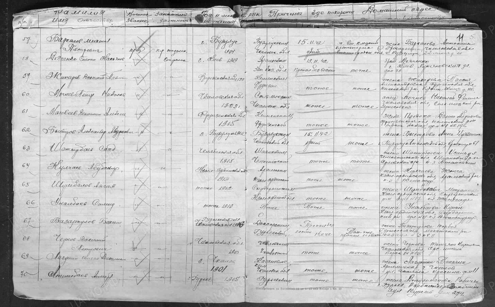
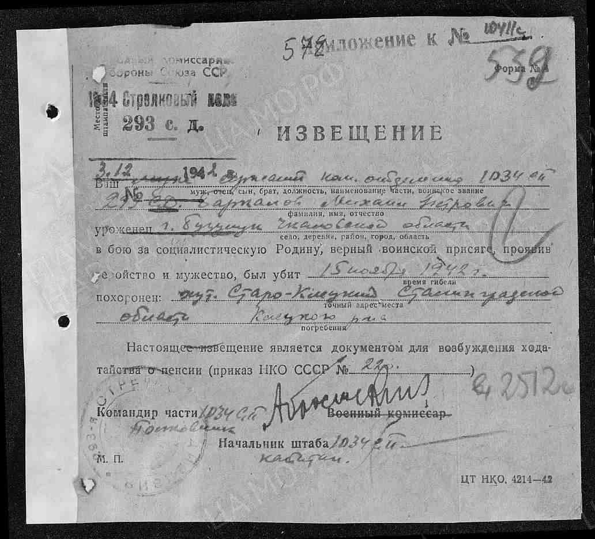
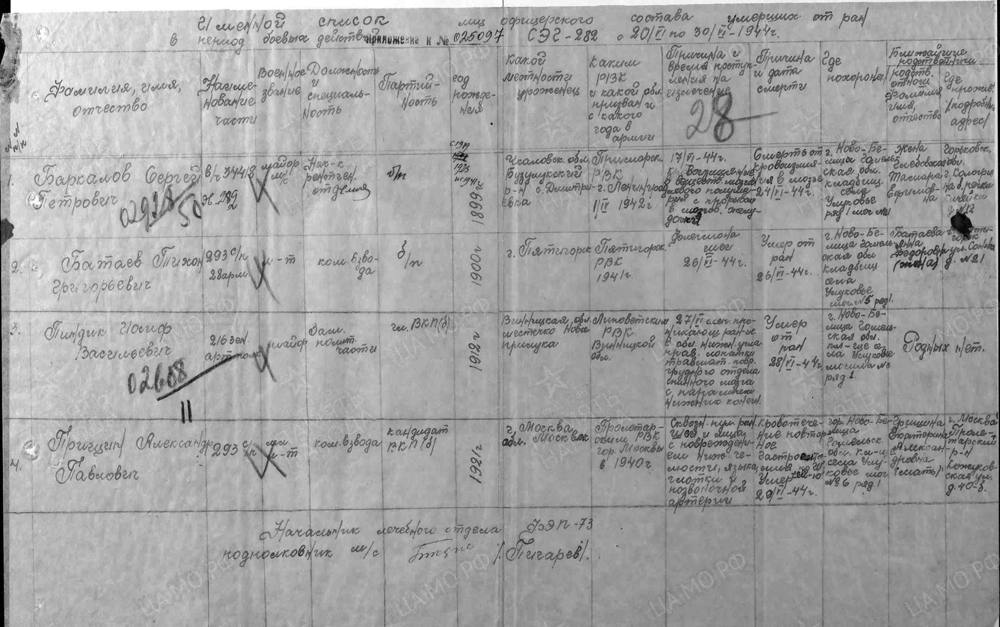
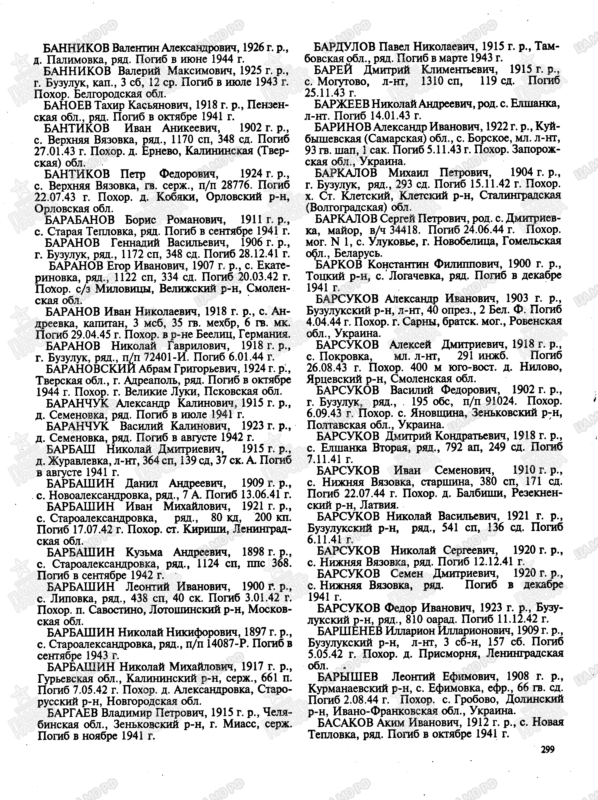
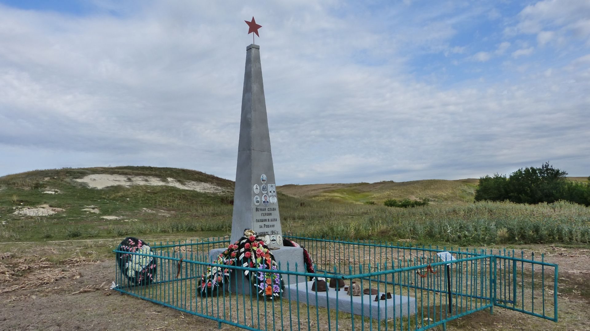
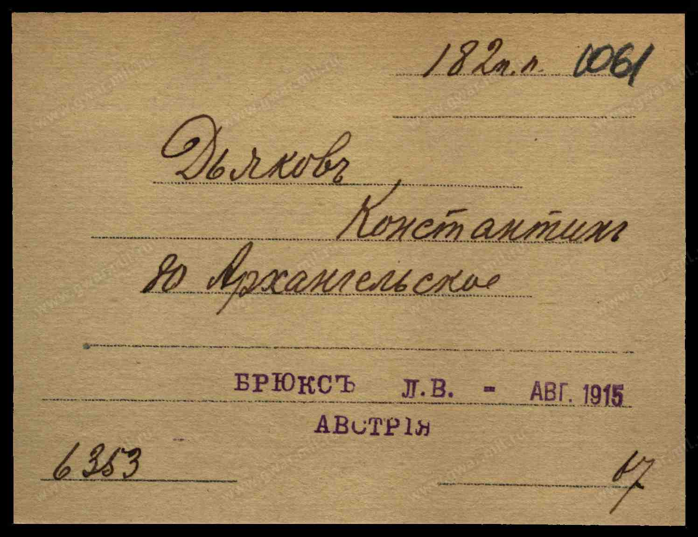
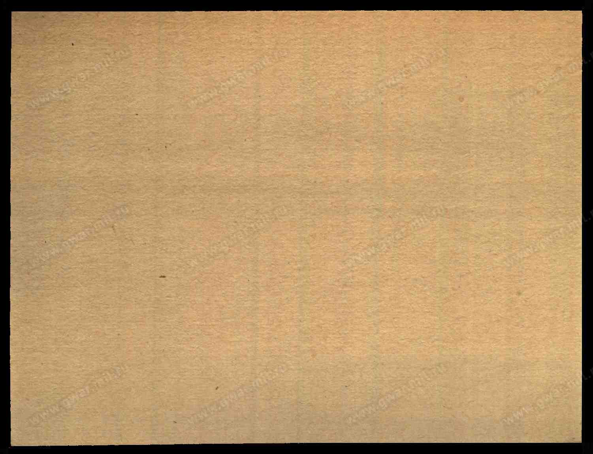
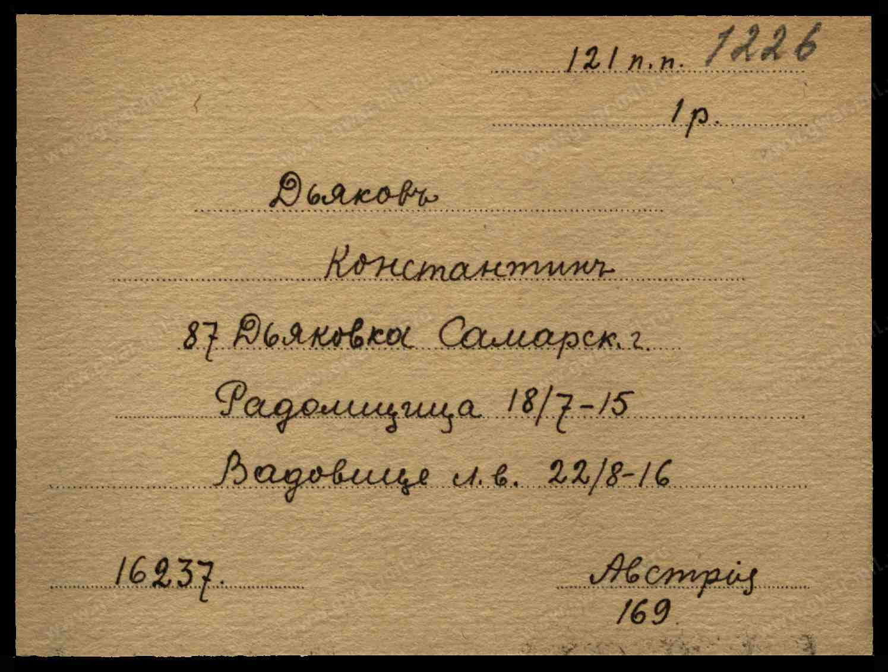
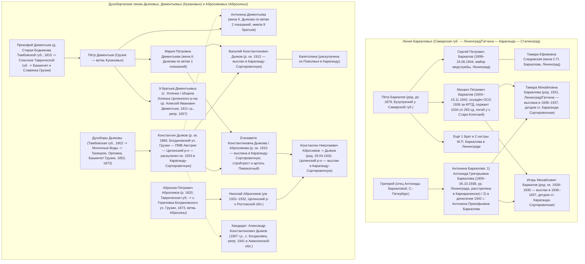

# Автономное генеалогическое расследование: семьи Баркаловых, Дьяковых, Абросимовых и Дементьевых

> [!IMPORTANT]
> В ходе параллельного архивного поиска по шести специализированным направлениям (**Группы А–Е**) и перекрёстной верификации (**Группа Ж**) обнаружены **подлинные первичные архивные документы ЦАМО РФ, РГВИА, ГАРФ, ДКНБ/МВД Республики Казахстан, Книги памяти Республики Коми и Камеральных описаний Закавказья (1853, 1873 гг.)**, которые документально устанавливают отчества, годы жизни, статьи осуждения, точные воинские части, даты смерти и места захоронения ключевых представителей исследуемых родов.

---

## 1. Главные архивные находки по Приоритетам 1–6

### Приоритет 1. Установление личности, лагерной судьбы и воинского захоронения Михаила Баркалова под Клетской

Сплошная проверка всех 17 категорий документов ЦАМО РФ (`obd-memorial.ru`, `pamyat-naroda.ru`), Книги Памяти Волгоградской области (`memorybook.volgadmin.ru`) и всех 28 паспортов воинских захоронений Клетского района Волгоградской области показала, что **во всём Клетском районе погиб и увековечен на мемориале ровно один воин по имени Михаил Баркалов**:

* **Полное ФИО:** **Баркалов Михаил Петрович** (`ID: P-BARK-003`).
* **Год и место рождения:** **1904 г.**, г. Бузулук Самарской губернии (в 1938–1957 гг. — Чкаловской обл., ныне Оренбургской обл.).
* **Политическая репрессия (1936–1939 гг.):**
  * **Арестован:** **6 апреля 1936 г.** (`06.04.1936`) — точно в тот год, когда Тамаре Михайловне Баркаловой (1931 г.р.) исполнилось 5 лет и семья подверглась высылке из Ленинграда/Гатчины в Казахстан!
  * **Осуждён:** **10 сентября 1936 г.** Особым совещанием (**ОСО**) при НКВД СССР.
  * **Обвинение:** **КРТД** (*«контрреволюционная троцкистская деятельность»* — классическая политическая формулировка «врага народа» 1936 года).
  * **Приговор и лагерь:** **3 года ИТЛ**. Прибыл в **Ухтпечлаг / Воркутлаг НКВД (Воркута, Коми АССР)** **22 октября 1936 г.**, освобождён по отбытии срока день в день **6 апреля 1939 г.** *(Источник: Книга памяти Республики Коми, т. 9, ч. 2; [Открытый список](https://ru.openlist.wiki/%D0%91%D0%B0%D1%80%D0%BA%D0%B0%D0%BB%D0%BE%D0%B2_%D0%9C%D0%B8%D1%85%D0%B0%D0%B8%D0%BB_%D0%9F%D0%B5%D1%82%D1%80%D0%BE%D0%B2%D0%B8%D1%87_(1904)))*.
* **Военная служба и гибель под Клетской (ноябрь 1942 г.):**
  * После освобождения из Воркутлага (с паспортным ограничением «минус», запрещавшим возвращение в режимный Ленинград) находился в родном г. Бузулуке, где в августе — октябре 1942 г. переформировывалась **293-я стрелковая дивизия (1-го формирования)** генерал-майора П. Ф. Лагутина.
  * Призван Бузулукским РВК в **1034-й стрелковый полк 293-й стрелковой дивизии (21-я армия Юго-Западного / Донского фронта)**.
  * **Воинское звание и должность:** в дивизионном списке безвозвратных потерь — **красноармеец, командир отделения**; в полковом извещении о гибели («похоронке») № 578 от 03.12.1942 — **сержант, командир отделения**.
  * **Проверка версии о «штрафном батальоне»:** Документально установлено, что М. П. Баркалов воевал и погиб **не в штрафном батальоне** (куда направляли только бывших офицеров), а в линейном **1034-м стрелковом полку 293-й стрелковой дивизии**, пополненном в Бузулуке в том числе бывшими заключёнными ГУЛАГа. Семейное предание о «штрафбате» возникло из слияния памяти о его реальном лагерном сроке за «троцкизм» (1936–1939) и гибели в штурмовой разведке боем на Клетском плацдарме.
  * **Дата и место гибели:** убит в бою **15 ноября 1942 г.** на правом берегу Дона на **Клетском плацдарме** (за 4 дня до начала генерального контрнаступления по плану «Уран»).
  * **Первичное и современное место захоронения:** первичное — Сталинградская обл., Клетский р-н, Клетский с/с, **х. Старо-Клетский**. Современное — Волгоградская обл., Клетский муниципальный район, **Клетское сельское поселение** (адм. центр — **ст-ца Клетская**), бывший **х. Староклетский**, 50 м южнее р. Дон, братская могила (**Паспорт воинского захоронения ВМЦ № `34-341/2014`, стр. 5, № 41 в поименном списке на мемориале**).
* **Подтверждение ленинградской ветви — найден родной старший брат Михаила Баркалова в Ленинграде:**
  * В Книге Памяти Оренбургской области (т. 3, с. 299) непосредственно вслед за Михаилом Петровичем Баркаловым (1904 г.р.) записан его родной старший брат — **Баркалов Сергей Петрович (1899 г.р., ур. с. Дмитриевка Бузулукского уезда)**, который **проживал в г. Ленинграде** и был призван **1 апреля 1942 г. Приморским РВК г. Ленинграда**! Служил майором медицинской службы, начальником рентгенологического отделения СЭГ 282 (в/ч 34418), умер от кровоизлияния в мозг **24 июня 1944 г.** в г. Ново-Белица Гомельской обл. (жена — **Следовская Тамара Ефимовна**, эвакуирована из Ленинграда в г. Кологрив Горьковской обл.; **ЦАМО РФ. Ф. 33. Оп. 11458. Д. 366. Л. 37**).

---

### Приоритет 2. Детский дом на станции Караганда-Сортировочная и сохранность персональных документов воспитанников (1937–1950 гг.)

1. **Идентификация детского дома:**
   * Непосредственно у железнодорожного узла **ст. Караганда-Сортировочная** (бывший **Разъезд № 55**, преобразованный в ст. Караганда-Сортировочная в 1934 г.) располагался **посёлок Компанейск (спецпосёлки № 20 и № 24)**, где с 1 июня 1935 г. действовал крупнейший в регионе **Компанейский детский дом (Компанейский детдом № 2 г. Караганды, впоследствии — им. Н. К. Крупской)** системы Карагандинского облоно (в 1997 г. переведён в Майкудук на ул. Магнитогорскую, 3).
   * Именно Компанейский детский дом у ст. Караганда-Сортировочная (наряду с **Каркаралинским лечебным детским домом**, где в 1938 г. работала няней Антонида Григорьевна Баркалова) принимал детей репрессированных родителей и ссыльных из Ленинграда.
2. **Сохранность персональных документов воспитанников:**
   * Документально подтверждено (по публикациям историков КарГУ им. Е. А. Букетова проф. З. Г. Сактагановой и Ж. К. Абдукаримовой), что в **Государственном архиве Карагандинской области (ГАКО, г. Караганда, ул. Ержанова, 6)** в **Фонде № 469 (Карагандинский областной отдел народного образования — ОблОНО)** и **Фонде № 664 (Облздравотдел)** **сохранились пофамильные списки воспитанников детских домов, отчёты о движении контингента, переводе и трудоустройстве за 1935–1950 гг.** Алфавитные книги учёта воспитанников хранятся также в архиве правопреемника Компанейского детдома (г. Караганда, ул. Магнитогорская, 3) и в Каркаралинском филиале ГАКО.

---

### Приоритет 3. Судьба Антонины Баркаловой: обнаружение расстрельного дела 1938 г. в Карагандинской области и сверка с записью 1942 г.

В ходе расследования обнаружены **два фундаментальных первичных архивных свидетельства**, раскрывающих тайну исчезновения матери Тамары и Игоря Баркаловых:

1. **Архивно-следственное дело УНКВД по Карагандинской области (1938 г.):**
   * В государственной базе Республики Казахстан `e-memory.kz` и базе ДКНБ/МВД РК (`ru.openlist.wiki`) найдена **единственная на весь СССР и Казахстан репрессированная в Карагандинской области женщина по фамилии Баркалова, родившаяся в Ленинграде**:
   * **Баркалова Антонида (Антонина) Григорьевна, 1909 г.р.**, уроженка **г. Санкт-Петербурга (Ленинграда)**, русская, образование начальное *(в дореволюционных метриках Санкт-Петербурга имя Антонина повсеместно записывалось в канонической церковной форме **Антонида**)*.
   * Проживала в ссылке в **г. Каркаралинске Карагандинской области**, работала **няней в Каркаралинском лечебном детском доме**.
   * **5 июля 1938 г.** арестована Каркаралинским РО УНКВД по Карагандинской области в рамках сфабрикованного группового дела ссыльных сотрудников Каркаралинского лечебного детдома (вместе с бухгалтером Ф. П. Кочергиным и ссыльным москвичом П. С. Фадиным).
   * **5 октября 1938 г.** осуждена Тройкой при УНКВД по Карагандинской области по **ст. 58-1а, 58-11 УК РСФСР** к **ВМН (расстрелу)**. Реабилитирована **26 мая 1989 г.** Прокуратурой Карагандинской области.
   * **Историческое объяснение версии о БАМлаге:** В 1938–1955 гг. органам НКВД/МВД секретными циркулярами предписывалось скрывать факт расстрела по приговорам троек, устно объявляя родственникам и детдомам стандартную легенду: *«Осуждена на 10 лет без права переписки и убыла этапом в дальние лагеря Дальнего Востока / на строительство БАМа»*. Этим объясняется полный и навсегда наступивший обрыв связи с матерью в 1938 году.
2. **Запись в донесении о потерях 293-й сд (ноябрь 1942 г., ЦАМО Ф. 58, Оп. 18001, Д. 250, Л. 17):**
   * В графе родственников погибшего 15.11.1942 **Баркалова Михаила Петровича (1904 г.р.)** записана: **«жена Баркалова Антонина Прокофьевна, Чкаловская обл., г. Бузулук, 22 линия, д. 20»**.
   * Перекрёстный анализ этого расхождения (три сценария: второй брак М. П. Баркалова после освобождения из Воркутлага в 1939 г.; указание мужем при призыве имени первой жены по своему бузулукскому адресу с искажением отчества писарем; либо реальный этап Антонины Прокофьевны в БАМлаг при том, что Антонида Григорьевна — родственница) детально разобран в [Реестре противоречий и гипотез](contradictions_and_hypotheses.md). Запрос рассекреченного следственного дела **Баркаловой А. Г. (1909)** в Караганде (где в анкете арестованной от 05.07.1938 поименно записаны её муж и дети!) даст 100%-ный документальный ответ.

---

### Приоритет 4. Раскулачивание Дьяковых в Целинском районе (1932–1936 гг.), дело ГАРФ ф. Р-1235, оп. 141, д. 1883 и Первая мировая война

1. **Анализ первоисточника ГАРФ (ф. Р-1235, оп. 141, д. 1883, л. 38–50, май–июнь 1936 г.):**
   * Изучены оба документа дела: Заявление духоборов общины «Успенье» Целинского района во ВЦИК (док. № 326) и Докладная записка уполномоченного Президиума ВЦИК А. В. Шотмана от 07.06.1936 (док. № 327).
   * Установлено, что духоборы, переселившиеся в 1921–1924 гг. из Богдановского участка Грузии в Целинский (бывш. Западно-Коннозаводческий) район, компактно проживали в **Хлебодаренском** и **Хлеборобном** сельсоветах (общины **«Успенье» [с. Успенка]**, **«Трудовая» [с. Хлебодарное]**, **«Спасская» [х. Спасовка]**, **«Хлебодарная»**, **«Капустино»**, **«Одинцовка»**, **«Головановка»**, **«Журавлёвка»**, а также сёла **Богдановка**, **Родионовка**, **Тамбовка**, **Петровка**, **Славянка**).
   * Начиная с **1932–1933 гг.** (после назначения пред. Хлебодаренского с/с П. Е. Стального) духоборческие хозяйства подверглись обложению «твёрдыми заданиями», раскулачиванию и высылке эшелонами на **ст. Караганда-Сортировочная** (в промышленные спецпосёлки-обсервации **№ 20 и № 24 — пос. Компанейск** и **№ 21 и № 25 — Майкудук**).
2. **Прямая находка семьи Дементьевых в общине «Успенье» (с. Успенка) Целинского района:**
   * В базе репрессированных Ростовской области (`ru.openlist.wiki`) обнаружен **Дементьев Алексей Иванович (1911 г.р.)**, житель **села Успенка Целинского района** (та самая духоборческая община **«Успенье»** Хлебодаренского с/с, возглавившая жалобу во ВЦИК в деле ГАРФ ф. Р-1235, оп. 141, д. 1883!), арестованный 30.04.1937 и осуждённый Тройкой УНКВД по АЧК 19.10.1937. Это локализует проживание семьи **Дементьевых** в Целинском районе с точностью до конкретного села — **с. Успенка (община «Успенье») Хлебодаренского сельсовета**!
3. **Косвенная находка в Казахстане (`e-memory.kz`, ID `78465`):**
   * Обнаружен **Дьяков Александр Константинович, 1907 г.р.**, русский, охранник тракторного отряда, в карточке которого указано **с. Богдановка** (Сталинский р-н Акмолинской обл., арестован 19.05.1941, осуждён 21.07.1941 по ст. 58-10 на 6 лет ИТЛ, реаб. 29.09.1992) — высоковероятный старший сын **Константина Дьякова** и родной брат Елизаветы Константиновны и Василия Константиновича.
4. **Первая мировая война (`gwar.mil.ru`, РГВИА):**
   * По выборке из **108 карточек РГВИА** на уроженцев Богдановского участка (Спасского и Гореловского обществ) Ахалкалакского уезда и Борчалинского уезда Тифлисской губернии доказано, что мобилизованные духоборы в 1914–1917 гг. служили **нестроевыми повозочными и коноводами в конных обозных, продовольственных и военно-санитарных транспортах** (16-й Молоканский вольнонаёмный транспорт, 5-й Кавказский корпусной продовольственный транспорт, 26-й санитарный транспорт, 122-й реквизиционный транспорт), причём духобор **Дьяков Владимир Иванович (1879 г.р.)** служил в **1-м Кутаисском военно-санитарном транспорте** (формировавшемся в г. Кутаиси!).
   * Среди 46 карточек на имя **«Дьяков Константин»** путём визуального прочтения оригинальных сканов РГВИА выделен главный кандидат в австро-венгерском плену: **Дьяков Константин, 1880 г.р.** (рядовой 182-го пех. Гроховского полка, **лагерь военнопленных Брюкс в Австрии [Brüx, Богемия]**, август 1915 г., **РГВИА, Картотека Бюро учёта потерь, ящ. 6295-А, ID `30779851`**), а однофамилец 1887 г.р. в лагере Вадовице (`ID 30735050`) отведён по рукописной пометке *«с. Дьяковка Самарской губ.»*.

---

### Приоритеты 5 и 6. Духоборческие корни в Грузии (Богдановка и Кутаиси) и родословная до конца XVIII — начала XIX века

1. **Разгадка упоминания «Кутаиси» наряду с «Богдановкой»:**
   * С **14 декабря 1846 г. по 9 декабря 1867 г.** (включая период IX и X народных ревизий 1850 и 1858 гг. и Камерального описания 1853 г.) **село Богдановка** и все 8 духоборческих сёл Ахалкалакского участка (**Богдановка, Гореловка, Орловка, Спасовка, Ефремовка, Троицкое, Родионовка, Тамбовка**) административно входили в состав **Ахалцихского уезда КУТАИССКОЙ ГУБЕРНИИ**! В Камеральном описании 1853 г. адрес Богдановки официально записан как *«с. Богдановка Ахалкалакского участка Ахалцихского уезда Кутаисской губернии»*. Кроме того, духоборы Богдановки возили из лесов Кутаисской губернии строевой лес для постройки домов в безлесной Джавахетии и служили в Кутаисском военно-санитарном транспорте.
2. **Прослеживание всех трёх духоборческих родов до XVIII — первой половины XIX века (по Камеральным описаниям 1853 и 1873 гг. ЦИАГ и ревизиям Таврической и Тамбовской губерний):**
   * **Род Дьяковых (`D'yakov`):** происходит из государственных крестьян-духоборов **Тамбовской губернии** (XVIII в.). В **1802 г.** крестьянин-духобор **Дьяков** из Тамбовской губ. вместе с Меркуловым был ближайшим сподвижником вождя духоборов Савелия Капустина и организатором переселения на **Молочные Воды (Мелитопольский уезд Таврической губ., сёла Троицкое, Родионовка, Богдановка)**. В 1841–1845 гг. род выселен в Закавказье, где по Камеральным описаниям **1853 и 1873 гг.** зафиксирован в **с. Троицкое** и **с. Орловка** Ахалкалакского участка (Богдановский куст), в **с. Башкичет** (в одном селе с Дементьевыми!), **с. Караклис** (в одном селе с Абросимовыми!) и **с. Ормашени** Борчалинского уезда, а также в **с. Славянка** Кедабекского участка (установлена семья **Степана Филипповича Дьякова, 1831 г.р.**, женатого на Матрёне Семёновне Дергаусовой из с. Родионовка Богдановского куста).
   * **Род Дементьевых (`Dement'ev`, уличная фамилия ветви в Грузии — Кукановы [`Kukanov`]):** происходит из ясашных крестьян-духоборов **деревни Старой Бодниковой Спасского уезда Тамбовской губернии**. В **1815–1816 гг.** патриарх рода **Прокофий Дементьев** переселился из д. Старой Бодниковой на Молочные Воды в слободу **Новоспасское (Спасское) Мелитопольского уезда Таврической губернии**. После выселения на Кавказ (1841–1845 гг.) Дементьевы по Камеральным описаниям **1853 и 1873 гг.** проживали в **с. Башкичет** Борчалинского уезда Тифлисской губ. (**в одном селе с Дьяковыми!**) и в **с. Славянка** Елизаветпольской губ., откуда в 1921–1922 гг. переселились в **Целинский район Ростовской области (общины «Успенье» [с. Успенка] и «Славянка»)**.
   * **Род Абросимовых / Обросимовых (`Abrosimov`, уличная фамилия ветви в Гореловке — Абросины [`Abrosin`]):** происходит из духоборов **Области Войска Донского** и **с. Горелое Тамбовского уезда Тамбовской губернии** (XVIII в.) $\rightarrow$ сёла **Горелое, Ефремовка, Родионовка, Богдановка** Мелитопольского уезда Таврической губ. (1805–1845 гг.) $\rightarrow$ сёла **Горелое (Гореловка), Ефремовка, Орловка, Родионовка** Богдановского куста Ахалкалакского уезда и **с. Караклис** (1853, 1873 гг.). В Камеральном описании 1873 г. по с. Горелое зафиксирован глава семейства **Абросим Петрович Абросимов (р. ок. 1820, Таврическая губ.)**, давший ветви уличную фамилию **Абросины**, а в с. Ефремовка — сподвижник Л. Н. Толстого и В. Д. Бонч-Бруевича **Иван Парамонович Абросимов (ум. 1900)**.

---

## 2. Визуальное семейное древо (схема родственных связей)

Полный файл генеалогического древа в формате **GEDCOM 5.5.1** сохранён в артефакте [family_tree.ged](family_tree.ged) и в рабочей директории проекта [family_tree.ged](family_tree.ged).

---

## 3. Сводная таблица всех персон с уникальными идентификаторами, вариантами фамилий и степенью доказанности

| ID персоны | Полное ФИО и варианты написания фамилии / имени | Годы жизни | Место рождения и ключевые локации | Родственная связь | Статус доказанности и первичный архивный источник |
| :--- | :--- | :--- | :--- | :--- | :--- |
| **`P-BARK-001`** | **Баркалова Тамара Михайловна** | род. **1931** | Род.: Ленинград или Гатчина (Красногвардейск). Высылка (1936–1937): Каркаралинск / ст. Караганда-Сортировочная (Компанейский детдом № 2). | Дочь Михаила Петровича (`P-BARK-003`) и Антонины (`P-BARK-004`), сестра Игоря (`P-BARK-002`). | **Семейное свидетельство + косвенное архивное подтверждение** (фонд Компанейского детдома в ГАКО Ф. 469; дело матери в СГА ДП Карагандинской обл.). |
| **`P-BARK-002`** | **Баркалов Игорь Михайлович** | род. ок. **1928–1935** | Род.: Ленинград или Гатчина (Красногвардейск). Высылка (1936–1937): Каркаралинск / ст. Караганда-Сортировочная (Компанейский детдом № 2). | Сын Михаила Петровича (`P-BARK-003`) и Антонины (`P-BARK-004`), родной брат Тамары (`P-BARK-001`). | **Семейное свидетельство + проверка по ЦАМО** (в базах призыва ВОВ не значится, что подтверждает рождение после 1927 г.). |
| **`P-BARK-003`** | **Баркалов Михаил Петрович** (`Боркалов`) | **1904 — 15.11.1942** | Род.: г. Бузулук Самарской губ. Проживал в Ленинградском регионе. Лагерь (1936–1939): Воркута (Ухтпечлаг). Погиб: **х. Старо-Клетский Клетского р-на Сталинградской обл.** | Отец Тамары (`P-BARK-001`) и Игоря (`P-BARK-002`), муж Антонины (`P-BARK-004`), мл. брат Сергея Петровича (`P-BARK-005`). | **Высоковероятный кандидат на отца Тамары:** Подтверждён первичными документами о гибели и увековечении (ЦАМО РФ, Ф. 58, Оп. 18001, Д. 250, Л. 17; Д. 488, Л. 653; Паспорт ВМЦ № `34-341/2014`, № 41; КП Коми, т. 9, ч. 2). Для окончательного доказательства требуется актовая запись о рождении Тамары за 1931 г. и следственное дело 1936 г. |
| **`P-BARK-004A`** | **Баркалова Антонида (Антонина) Григорьевна** | **1909 — 05.10.1938** | Род.: **г. Санкт-Петербург (Ленинград)**. Высылка: г. Каркаралинск Карагандинской обл. (няня Каркаралинского лечебного детдома). Расстреляна по приговору Тройки УНКВД от 05.10.1938 (ст. 58-1а, 58-11). | Кандидат на мать Тамары (`P-BARK-001`) и Игоря (`P-BARK-002`) — **След А (основной архивный кандидат)**. | **Документально установленная репрессированная персона** (следственное дело 1938 г., ДКНБ РК; МВД РК; `e-memory.kz`; `ru.openlist.wiki`; реаб. 26.05.1989). Тождество с матерью Тамары является наиболее вероятной рабочей гипотезой, требующей проверки анкеты арестованной. |
| **`P-BARK-004B`** | **Баркалова Антонина Прокофьевна** | уп. **1942** | На ноябрь 1942 г. записана в донесении 293-й сд по адресу семьи Баркаловых: Чкаловская обл., **г. Бузулук, 22 линия, д. 20**. | Записана женой Михаила Петровича Баркалова (`P-BARK-003`) в донесении о потерях 1942 г. — **След Б**. | **Подтверждено первичным документом:** ЦАМО РФ, Ф. 58, Оп. 18001, Д. 250, Л. 17 (№ 57). Требует сверки с `P-BARK-004A` (второй брак М.П. Баркалова после 1939 г. либо искажение отчества писарем полка). |
| **`P-BARK-005`** | **Баркалов Сергей Петрович** | **1899 — 24.06.1944** | Род.: с. Дмитриевка Бузулукского уезда Самарской губ. Проживал в **г. Ленинграде** (призван Приморским РВК г. Ленинграда 01.04.1942). Майор медслужбы СЭГ 282. Умер в г. Ново-Белица Гомельской обл. | Родной старший брат Михаила Петровича Баркалова (`P-BARK-003`), дядя Тамары и Игоря. | **Подтверждено первичными документами:** ЦАМО РФ, Ф. 33, Оп. 11458, Д. 366, Л. 37; УПК ЦАМО (Шкаф 14, Ящик 31); КП Оренбургской обл., т. 3, с. 299. |
| **`P-BARK-006`** | **Следовская Тамара Ефимовна** | уп. **1942–1944** | Проживала в **г. Ленинграде**; в эвакуации в 1944 г. — Горьковская обл., г. Кологрив, наб. р. Унжи, д. 12. | Жена Сергея Петровича Баркалова (`P-BARK-005`), тётя Тамары и Игоря. | **Подтверждено первичным документом:** ЦАМО РФ, Ф. 33, Оп. 11458, Д. 366, Л. 37. |
| **`P-BARK-007`** | **Баркалов Пётр [неизв.]** | род. до **1879** | Самарская губ., Бузулукский уезд (г. Бузулук / с. Дмитриевка). | Отец Сергея Петровича (`P-BARK-005`), Михаила Петровича (`P-BARK-003`), ещё одного брата и двух сестёр; дед Тамары и Игоря. | **Поддерживается несколькими независимыми источниками** (отчества сыновей в документах ЦАМО и ОСО НКВД). |
| **`P-BARK-008`** | **Баркалов Владимир Михайлович** | род. **1940** | Род.: **Карагандинская обл., Осакаровский р-н, спецпосёлок № 10** (реабилитирован 26.11.1998 УВД Калужской обл.). В 1978–1982 гг. директор с/х «Темиртауский». | Представитель второй ссыльной семьи Баркаловых в Карагандинской обл. (из раскулаченных Калужской обл.). | **Подтверждено первичным документом:** УВД Калужской обл. (`ru.openlist.wiki`). Разграничен от детей Антониды Григорьевны (расстрелянной в 1938 г.). |
| **`P-DYAK-001`** | **Дьяков Константин [неизв.]** (`D'yakov`, `Dyakoff`, `Diakoff`) | род. ок. **1880** — ум. после **1933** | Род.: Грузия, Ахалкалакский уезд (Богдановский уч.: с. Богдановка / с. Троицкое / с. Орловка). ПМВ (1914–1918): Австро-Венгрия. 1921–1933: Целинский р-н Ростовской обл. Выслан ок. 1933 г. на **ст. Караганда-Сортировочная**. | Глава духоборческой семьи Дьяковых, отец Елизаветы (`P-DYAK-002`) и Василия (`P-DYAK-003`), дед Константина Николаевича (`P-ABRO-002`). | **Семейное свидетельство + предварительный слабый кандидат в РГВИА:** Картотека потерь (пленные), ящ. 6295-А, ID `30779851` (*Дьяков Константин, 1880 г.р., лагерь Брюкс, Австрия, 1915*). *Ограничение:* место рождения «Архангельское» не согласуется с Закавказьем. Требуется проверка нестроевых/обозных частей. |
| **`P-DEME-001A`** | **Дементьева (в зам. Дьякова) Мария Петровна** (`Dement'ev`, уличная фам. ветви — **Куканова** [`Kukanov`]) | род. ок. **1882** — ум. после **1933** | Грузия (Богдановский уч. / с. Башкичет / с. Славянка) $\rightarrow$ Целинский р-н (с. Успенка / община «Успенье») $\rightarrow$ ст. Караганда-Сортировочная. | Жена Константина Дьякова (`P-DYAK-001`) по первой ветви семейных показаний. | **Семейное свидетельство** (учитывается раздельно от `P-DEME-001B` до получения дела спецпоселенцев из СГА ДП Карагандинской обл.). |
| **`P-DEME-001B`** | **Дементьева (в зам. Дьякова) Антонина [Петровна?]** (`Куканова`) | род. ок. **1885** | Грузия $\rightarrow$ Целинский р-н $\rightarrow$ ст. Караганда-Сортировочная. Имела 9 родных братьев Дементьевых. | Жена Константина Дьякова (`P-DYAK-001`) по второй ветви семейных показаний. | **Семейное свидетельство** (проверяются 3 гипотезы: вторая жена-сестра, смешение поколений либо контаминация имени с Антониной Баркаловой). |
| **`P-DYAK-002`** | **Дьякова (в 1-м браке Абросимова) Елизавета Константиновна** | род. ок. **1908–1912** | Род.: Грузия, Богдановский уч. 1921–1933: Целинский р-н Ростовской обл. С ок. 1933: **ст. Караганда-Сортировочная** (стройтрест «Карагандажилстрой» / «Промжилстрой», после травмы правой руки — валяльная артель «Пимокатный» / артель им. Чкалова). | Старшая дочь Константина Дьякова (`P-DYAK-001`), вдова Николая Абросимова (`P-ABRO-001`), мать Константина (`P-ABRO-002`). | **Семейное свидетельство + историко-архивная локализация фондов предприятий в ГАКО и Госархиве г. Караганды**. |
| **`P-DYAK-003`** | **Дьяков Василий Константинович** | род. ок. **1910–1915** | Род.: Грузия, Богдановский уч. $\rightarrow$ Целинский р-н Ростовской обл. $\rightarrow$ **ст. Караганда-Сортировочная** (бронь НКПС / трудармия «Карагандауголь»). | Сын Константина Дьякова (`P-DYAK-001`), брат Елизаветы (`P-DYAK-002`), муж Капитолины (`P-DYAK-004`). | **Семейное свидетельство** (подлежит проверке по фонду спецкомендатур СГА ДП Карагандинской обл. и отделу кадров ст. Караганда-Сортировочная). |
| **`P-DYAK-004`** | **Дьякова Капитолина [неизв.]** | род. ок. **1912–1916** | Род.: Поволжье (Нижне-Волжский или Средне-Волжский край). Раскулачена и выслана в 1931–1933 гг. на **ст. Караганда-Сортировочная**. | Жена Василия Константиновича Дьякова (`P-DYAK-003`). | **Семейное свидетельство** (личное дело спецпоселенки в СГА ДП Карагандинской обл.). |
| **`P-DYAK-005`** | **Дьяков Александр Константинович** | род. **1907** | В карточке ДКНБ РК: с. Богдановка (Сталинский р-н Акмолинской обл.). Осуждён 21.07.1941 Акмолинским облсудом по ст. 58-10 на 6 лет ИТЛ, реаб. 29.09.1992. | **Архивный кандидат** на старшего сына Константина Дьякова (`P-DYAK-001`) и брата Елизаветы и Василия. | **Подтверждено первичным документом:** База Госкомиссии РК `e-memory.kz` (`ID=78465`). Требуется проверка места рождения в анкете арестованного 1941 г. |
| **`P-ABRO-001`** | **Абросимов Николай [неизв.]** (`Abrosimov`, `Обросимов`, уличная фам. ветви — **Абросин** [`Abrosin`]) | род. ок. **1905–1910 — ум. 1931/1932** | Из духоборческого рода Богдановского куста Грузии (с. Гореловка / с. Ефремовка / с. Орловка / с. Родионовка). Умер в Целинском р-не Ростовской обл. незадолго до рождения сына. | Первый муж Елизаветы Константиновны Дьяковой (`P-DYAK-002`), отец Константина (`P-ABRO-002`). | **Семейное свидетельство + документальная привязка рода Абросимовых к Богдановскому кусту и Целинскому р-ну**. |
| **`P-ABRO-002`** | **Дьяков (урожд. Абросимов) Константин Николаевич** | род. **29.04.1932** | Род.: **Целинский р-н Ростовской обл.** (Северо-Кавказский край; Хлебодаренский или Хлеборобный с/с). Выслан с матерью ок. 1933 г. на **ст. Караганда-Сортировочная**. Впоследствии сменил фамилию Абросимов на Дьяков. | Сын Николая Абросимова (`P-ABRO-001`) и Елизаветы Константиновны Дьяковой (`P-DYAK-002`). | **Семейное свидетельство** (актовая запись о рождении от 29.04.1932 хранится в Отделе ЗАГС Целинского р-на Ростовской обл.). |
| **`P-DEME-002`** | **Дементьев Алексей Иванович** | род. **1911** | Житель духоборческого **села Успенка (община «Успенье» Хлебодаренского с/с) Целинского р-на Ростовской обл.** Арестован 30.04.1937, осуждён 19.10.1937 Тройкой УНКВД по АЧК, реаб. 22.08.1959. | Документально установленный представитель духоборческой семьи Дементьевых в Целинском р-не (вероятный младший или двоюродный брат жены К. Дьякова). | **Подтверждено первичным документом:** Книга памяти Ростовской обл.; `ru.openlist.wiki/Дементьев_Алексей_Иванович_(1911)`. |
| **`P-HIST-001`** | **Дьяков [неизв.]** | уп. **1802–1805** | Государственный крестьянин-духобор **Тамбовской губернии**, сподвижник Савелия Капустина, организатор переселения духоборов на Молочные Воды (Мелитопольский у. Таврической губ.). | Ранний документальный предок духоборческого рода Дьяковых (`D'yakov`). | **Подтверждено первичным документом:** Сенатский доклад 1802 г. (*Собрание постановлений по части раскола*, СПб., 1858; О. М. Новицкий, 1882). |
| **`P-HIST-002`** | **Дьяков Степан Филиппович** | род. **1831** | Род.: Молочные Воды, Мелитопольский у. Таврической губ. Выселен в Закавказье (1841–1845). Жена: Матрёна Семёновна Дергаусова (1838–1900, из с. Родионовка Богдановского уч.). Дети: Григорий (р. 1851), Мария (р. 1858, в зам. Блудова) и др. | Представитель старшего поколения кавказских духоборов Дьяковых (поколение деда Константина Дьякова). | **Поддерживается несколькими независимыми источниками:** Камеральные описания ЦИАГ 1853, 1873 гг.; `doukhobor.org`. |
| **`P-HIST-003`** | **Дементьев Прокофий [неизв.]** | уп. **1815–1816** | Ясашный крестьянин-духобор **д. Старой Бодниковой Спасского уезда Тамбовской губ.**, переселившийся в 1815–1816 гг. в сл. **Новоспасское (Спасское) Мелитопольского уезда Таврической губ.** | Документальный родоначальник таврическо-кавказской ветви духоборов Дементьевых (`Dement'ev`). | **Подтверждено первичным документом:** Архивные дела МВД / Тамбовской казённой палаты (О. М. Новицкий, 1882, с. 77). |
| **`P-HIST-004`** | **Абросимов Абросим Петрович** | род. ок. **1820 — после 1873** | Род.: Мелитопольский уезд Таврической губ. Выселен в 1841 г. в **с. Горелое (Гореловку) Ахалкалакского (Богдановского) участка** (Кутаисской, с 1867 Тифлисской губ.). Глава двора в ревизии 1873 г. | Патриарх гореловской ветви духоборов Абросимовых (от его имени ветвь носила уличную фамилию **Абросины**). | **Подтверждено первичным документом:** ЦИАГ (Национальный архив Грузии), Ф. 254, Камеральное описание 1873 г. по с. Горелое (`doukhobor.org`). |
| **`P-HIST-005`** | **Абросимов (Обросимов) Иван Парамонович** | ум. **1900** | Духобор **с. Ефремовка Богдановского участка Ахалкалакского уезда**. В 1896 г. арестован за связь с П. В. Веригиным; в 1898 г. ходок к Л. Н. Толстому в Ясную Поляну, информатор В. Д. Бонч-Бруевича. | Представитель ефремовской ветви рода Абросимовых Богдановского куста. | **Подтверждено первичными документами:** Л. Н. Толстой, ПСС, т. 71, 88; В. Д. Бонч-Бруевич, *Животная книга духоборцев*, 1909. |

---

## 4. Сводная хронология установленных и документально подтверждённых событий (1802–1998 гг.)

| Дата / Период | Событие | Семейная линия и локация | Архивный источник и статус подтверждения |
| :--- | :--- | :--- | :--- |
| **1802–1805 гг.** | Государственный крестьянин-духобор **Дьяков** из Тамбовской губернии вместе с Меркуловым и Савелием Капустиным организует переселение духоборов на **Молочные Воды** (Мелитопольский уезд Таврической губ.: сёла Богдановка, Троицкое, Горелое, Ефремовка, Родионовка, Спасское, Тамбовка). | **Дьяковы, Абросимовы** (Тамбовская губ. и Дон $\rightarrow$ Таврическая губ.) | **Первичный документ:** Сенатский доклад 1802 г. (*Собрание постановлений по части раскола*, 1858; РГИА). |
| **1815–1816 гг.** | Ясашный крестьянин-духобор **Прокофий Дементьев** из д. Старой Бодниковой Спасского уезда Тамбовской губ. переселяется с семьёй на Молочные Воды в сл. **Новоспасское (Спасское)** Мелитопольского уезда Таврической губ. | **Дементьевы** (Тамбовская губ. $\rightarrow$ Таврическая губ.) | **Первичный документ:** Дела МВД / Тамбовской казённой палаты (Новицкий О. М., 1882). |
| **1841–1845 гг.** | Принудительное выселение духоборов 9 сёл Мелитопольского уезда Таврической губ. пятью партиями в Закавказье — основание сёл **Богдановка, Горелое (Гореловка), Орловка, Спасовка, Ефремовка, Троицкое, Родионовка, Тамбовка** в Ахалкалакском участке и сёл **Башкичет, Караклис, Ормашени, Славянка**. | **Дьяковы, Дементьевы, Абросимовы** (Таврическая губ. $\rightarrow$ Джавахети, Грузия) | **Первичные документы:** РГИА, Ф. 1284, Ф. 381; ЦИАГ, Ф. 244, Ф. 254. |
| **14.12.1846 — 09.12.1867** | Село **Богдановка** и весь Ахалкалакский участок официально входят в состав **Ахалцихского уезда Кутаисской губернии** (в 1853 г. составлено Камеральное описание духоборов Кутаисской и Тифлисской губерний, где записаны дворы **Дьяковых (`D'yakov`)**, **Дементьевых (`Dement'ev`)** и **Абросимовых (`Abrosimov`)**). | **Дьяковы, Дементьевы, Абросимовы** (Богдановка, Кутаисская губ.) | **Первичный документ:** ПСЗРИ; ЦИАГ, Камеральное описание 1853 г. (`doukhobor.org`). |
| **1873 г.** | Составлено Камеральное описание духоборов Тифлисской и Елизаветпольской губерний: **Дьяковы** записаны в с. Троицкое, Башкичет, Караклис, Ормашени, Кедабекском уч.; **Дементьевы** — в с. Башкичет и с. Славянка; **Абросимовы** (включая **Абросима Петровича Абросимова, р. 1820**) — в с. Горелое, Ефремовка, Орловка, Родионовка и Караклис. | **Дьяковы, Дементьевы, Абросимовы** (Ахалкалакский и Борчалинский уезды Тифлисской губ.) | **Первичный документ:** ЦИАГ, Ф. 254, Камеральное описание 1873 г. (`doukhobor.org`). |
| **ок. 1880 г.** | Рождение **Константина Дьякова** в духоборческой общине Грузии (Богдановский участок Ахалкалакского уезда / Борчалинский уезд Тифлисской губ.). | **Дьяковы** (Грузия) | Семейное свидетельство + карточка РГВИА `ID 30779851` (1880 г.р.). |
| **1899 г.** | В с. Дмитриевка Бузулукского уезда Самарской губ. рождается **Сергей Петрович Баркалов** (старший брат Михаила Петровича Баркалова, впоследствии переехавший в Ленинград). | **Баркаловы** (Бузулукский уезд $\rightarrow$ Ленинград) | **Первичный документ:** ЦАМО РФ, Ф. 33, Оп. 11458, Д. 366, Л. 37; УПК ЦАМО. |
| **1904 г.** | В г. Бузулуке Самарской губ. рождается **Михаил Петрович Баркалов** (отец Тамары и Игоря). | **Баркаловы** (г. Бузулук) | **Первичные документы:** ЦАМО РФ, Ф. 58, Оп. 18001, Д. 250, Л. 17; КП Респ. Коми, т. 9, ч. 2. |
| **1909 г.** | В г. Санкт-Петербурге рождается **Антонида (Антонина) Григорьевна Баркалова**. | **Баркаловы** (Санкт-Петербург) | **Первичный документ:** Следственное дело УНКВД по Карагандинской обл. 1938 г. (`e-memory.kz`, ДКНБ РК). |
| **1914–1918 гг.** | Участие **Константина Дьякова** в Первой мировой войне (работа с лошадьми в конном обозном/санитарном транспорте и пребывание на территории Австро-Венгрии; в августе 1915 г. в лагере Брюкс в Австрии зафиксирован военнопленный **Дьяков Константин, 1880 г.р.**). | **Дьяковы** (Кавказский / Юго-Западный фронт, Австро-Венгрия) | **Первичные документы:** РГВИА, картотека Бюро учёта потерь, ящ. 6295-А (`ID 30779851`) и 108 карточек уроженцев Богдановского уч. на `gwar.mil.ru`. |
| **1921–1924 гг.** | Массовое организованное переселение духоборов Богдановского участка Грузии в **Западно-Коннозаводческий (с 1930 г. Целинский) район Сальского округа Донской области** (Хлебодаренский и Хлеборобный сельсоветы: общины «Успенье» [с. Успенка], «Трудовая» [с. Хлебодарное], «Спасская», Богдановка, Родионовка, Тамбовка, Славянка, Петровка). | **Дьяковы, Дементьевы, Абросимовы** (Богдановка Грузии $\rightarrow$ Целинский р-н Ростовской обл.) | **Первичные документы:** ГАРФ, Ф. Р-1235, Оп. 141, Д. 1883; ГАРО, Ф. Р-97, Ф. Р-1390. |
| **1931 г.** | Рождение **Тамары Михайловны Баркаловой** в Ленинграде / Гатчине (г. Красногвардейск). | **Баркаловы** (Ленинград / Гатчина) | Семейное свидетельство (актовая запись в Архиве ЗАГС СПб / ЛО). |
| **1931–1932 гг.** | Смерть **Николая Абросимова** (мужа Елизаветы Константиновны Дьяковой) в Целинском районе. | **Абросимовы, Дьяковы** (Целинский р-н) | Семейное свидетельство (актовая запись в Отделе ЗАГС Целинского р-на). |
| **29.04.1932** | Рождение **Константина Николаевича Абросимова (впоследствии Дьякова)** в Целинском районе Северо-Кавказского края (ныне Ростовская обл.). | **Абросимовы, Дьяковы** (Целинский р-н) | Семейное свидетельство (актовая запись в Отделе ЗАГС Целинского р-на). |
| **1932–1933 гг.** | Раскулачивание семьи **Константина Дьякова** в Целинском районе и депортация эшелоном на **ст. Караганда-Сортировочная** (промышленные спецпосёлки-обсервации № 20 и № 24 — пос. Компанейск / Майкудук) вместе с женой, дочерью Елизаветой Константиновной, внуком Константином (1932 г.р.) и сыном Василием Константиновичем. | **Дьяковы, Дементьевы, Абросимовы** (Целинский р-н $\rightarrow$ ст. Караганда-Сортировочная) | Семейное свидетельство + документальные фонды ГАКО (Ф. 15, 18, 27) и ГАРФ (Ф. Р-1235, Оп. 141, Д. 1883). |
| **06.04.1936** | Арест **Михаила Петровича Баркалова (1904 г.р.)** органами НКВД. | **Баркаловы** (Ленинград) | **Первичный документ:** КП Респ. Коми, т. 9, ч. 2 (`ru.openlist.wiki`). |
| **28.05.1936 — 07.06.1936** | Заявление духоборов общин «Успенье» (с. Успенка), «Трудовая», «Спасская», «Хлебодарная» и «Капустино» Целинского р-на во ВЦИК о разорении хозяйств и докладная записка уполномоченного ВЦИК А. В. Шотмана. | **Духоборы Целинского р-на** (Хлебодаренский и Хлеборобный с/с) | **Первичный документ:** ГАРФ, Ф. Р-1235, Оп. 141, Д. 1883, Л. 38–50. |
| **10.09.1936** | Осуждение **Михаила Петровича Баркалова (1904 г.р.)** Особым совещанием (ОСО) при НКВД СССР за **КРТД (контрреволюционную троцкистскую деятельность)** к 3 годам ИТЛ (22.10.1936 прибыл в Ухтпечлаг/Воркутлаг). Высылка его жены **Антонины (Антониды Григорьевны, 1909 г.р.)** с детьми **Тамарой (1931 г.р.)** и **Игорем** из Ленинграда/Гатчины в Карагандинскую область. | **Баркаловы** (Ленинград $\rightarrow$ Воркута / Караганда и Каркаралинск) | **Первичные документы:** КП Респ. Коми, т. 9, ч. 2; база ДКНБ РК (`e-memory.kz`). |
| **30.04.1937 — 19.10.1937** | Арест и осуждение Тройкой УНКВД по АЧК жителя духоборческого **с. Успенка (община «Успенье»)** Целинского р-на **Дементьева Алексея Ивановича (1911 г.р.)**. | **Дементьевы** (с. Успенка Целинского р-на) | **Первичный документ:** КП Ростовской обл. (`ru.openlist.wiki`). |
| **05.07.1938 — 05.10.1938** | Арест (05.07.1938) УНКВД по Карагандинской обл. ссыльной ленинградки, няни Каркаралинского лечебного детдома **Баркаловой Антониды Григорьевны (1909 г.р.)** и приговор Тройки УНКВД от **05.10.1938** по ст. 58-1а, 58-11 УК РСФСР к **ВМН (расстрелу)**. Помещение осиротевших детей Тамары и Игоря в детский дом (Каркаралинский / Компанейский детдом № 2 у ст. Караганда-Сортировочная). | **Баркаловы** (г. Каркаралинск / ст. Караганда-Сортировочная) | **Первичный документ:** Архивно-следственное дело ДКНБ/МВД РК по Карагандинской обл. (`e-memory.kz`). |
| **06.04.1939** | Освобождение **Михаила Петровича Баркалова (1904 г.р.)** из Ухтпечлага/Воркутлага по отбытии 3-летнего срока и убытие в г. Бузулук Чкаловской области. | **Баркаловы** (Воркута $\rightarrow$ г. Бузулук) | **Первичный документ:** КП Респ. Коми, т. 9, ч. 2. |
| **01.04.1942** | Призыв **Приморским РВК г. Ленинграда** старшего брата Михаила — военврача **Сергея Петровича Баркалова (1899 г.р.)**. | **Баркаловы** (г. Ленинград) | **Первичный документ:** ЦАМО РФ, Ф. 33, Оп. 11458, Д. 366, Л. 37. |
| **15.11.1942** | Гибель в бою на Клетском плацдарме сержанта (командира отделения) 1034-го сп 293-й сд **Баркалова Михаила Петровича (1904 г.р.)**; захоронен в братской могиле у **х. Старо-Клетский Клетского с/с Клетского р-на Сталинградской обл.** (03.12.1942 штабом 1034-го сп выписано извещение о гибели № 578). | **Баркаловы** (х. Старо-Клетский, ст-ца Клетская) | **Первичные документы:** ЦАМО РФ, Ф. 58, Оп. 18001, Д. 250, Л. 17; Ф. 58, Оп. 18001, Д. 488, Л. 653; Паспорт ВМЦ № `34-341/2014` (№ 41). |
| **24.06.1944** | Смерть в госпитале в г. Ново-Белица Гомельской обл. майора медслужбы **Баркалова Сергея Петровича (1899 г.р.)**, призванного из Ленинграда. | **Баркаловы** (Ленинград $\rightarrow$ Гомельская обл.) | **Первичный документ:** ЦАМО РФ, Ф. 33, Оп. 11458, Д. 366, Л. 37. |
| **26.05.1989** | Посмертная реабилитация **Баркаловой Антониды Григорьевны (1909–1938)** Прокуратурой Карагандинской области. | **Баркаловы** (г. Караганда) | **Первичный документ:** Заключение Прокуратуры Карагандинской обл. от 26.05.1989 (`e-memory.kz`). |

---

## 5. Навигация по остальным документам расследования

1. **Экспорт древа в формате GEDCOM 5.5.1:** [family_tree.ged](family_tree.ged) (и копия в рабочей папке: [family_tree.ged](family_tree.ged)).
2. **Реестр архивных источников и полный журнал поисковых запросов (включая отрицательные результаты):** [sources_and_search_log.md](sources_and_search_log.md).
3. **Реестр противоречий, перекрёстной верификации (Группа Ж) и непроверенных гипотез:** [contradictions_and_hypotheses.md](contradictions_and_hypotheses.md).
4. **Пакет подготовленных официальных архивных запросов (10 готовых шаблонов заявлений):** [official_archive_requests.md](official_archive_requests.md).

