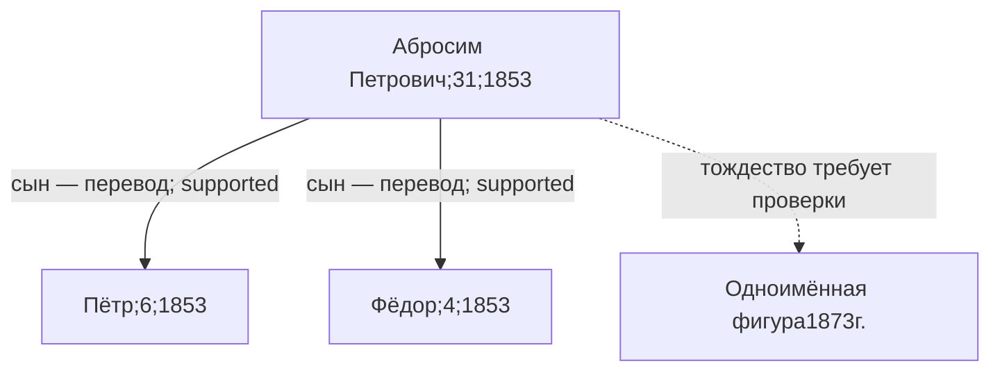

# Историческое хозяйство1853г. — отдельная исследовательская ветвь

`P-HIST-1853-ABROSIM`: Абросим Петрович,31год, глава хозяйства в Горелом; сыновья `P-HIST-1853-PETR` (Пётр,6лет) и `P-HIST-1853-FYODOR` (Фёдор,4года). По опубликованному переводу1853г., печатнаяс.65, PDF-страница73/103, нижняя группа. Содержание строки проверено визуально оркестратором, независимо рассмотрено аудитором по публикации. Русский архивный оригинал не проверен; статус связей — `supported`.

Источник `S-CAU-1853`, утверждения `C-CAU-001`, `C-CAU-PARENT-PETR/FYODOR`. Тождество главы с прежней записью1873г. `P-HIST-004` не установлено (`C-ID-004`). Потомство до Николая Абросимова не реконструировано. Эти люди пока **не родственники заказчика в доказательном графе**.

Следующая работа `T-CAU-002`: сверить оригинальный лист и продолжение хозяйства1873г., не перескакивать поколений.
