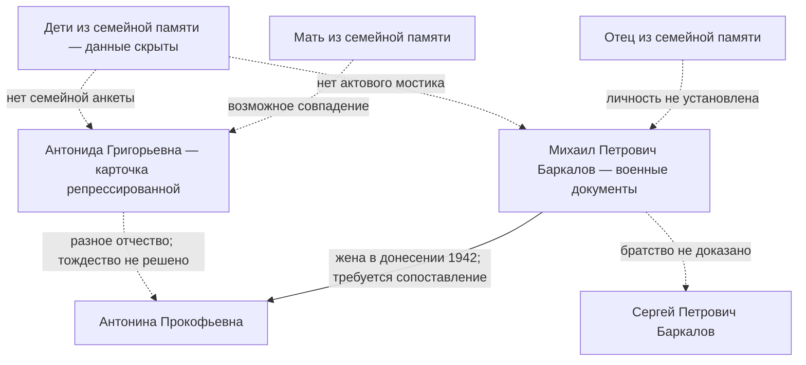

# Отождествления, требующие доказательств

Пунктир обозначает гипотезу. Сплошная линия означает только отношение, записанное в конкретном документе, а не установленную связь с семьёй заказчика.

Древо доказанных прямых предков пока не может быть построено: сначала необходим исходный актовый мост. Имена/даты потенциально живых людей не воспроизводятся. См. `../claims.json`, `../relationships.json`, `../cycle_001.md`.
