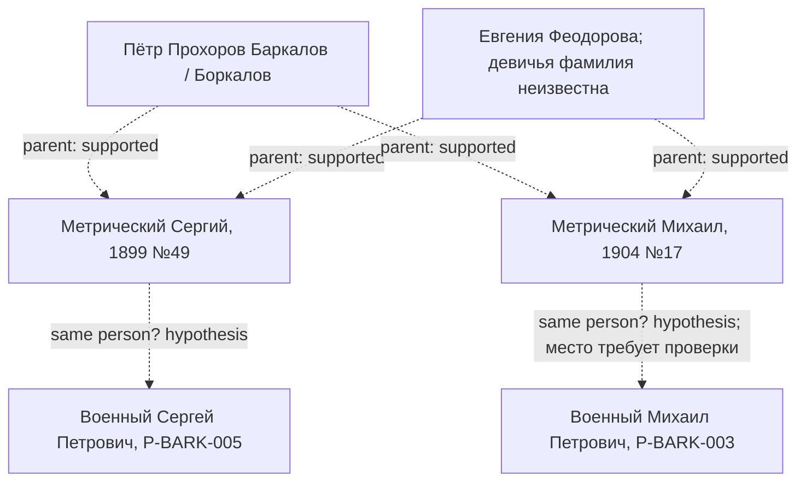

# Отдельная метрическая группа, связь с заказчиком не установлена

Пунктирные стрелки parent означают `supported`: родители прямо записаны в актах, а общность пары между актами является оговорённым косвенным выводом. Нижние стрелки — только гипотезы тождества со взрослыми. Схема не устанавливает военное братство и не включена в основной GEDCOM.

Доказательная записка: `../biographies/metric_family_1899_1904.md`. Полные ID, основания и статусы — в реестрах.
